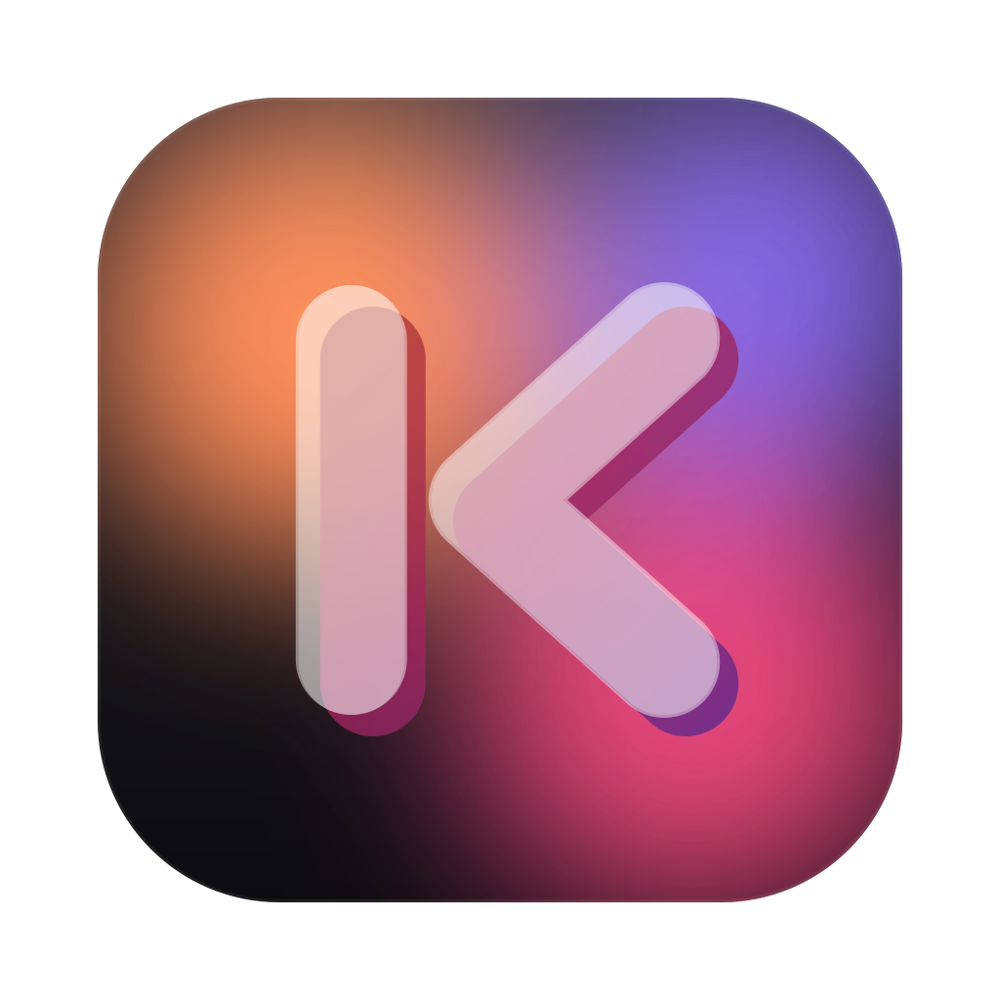
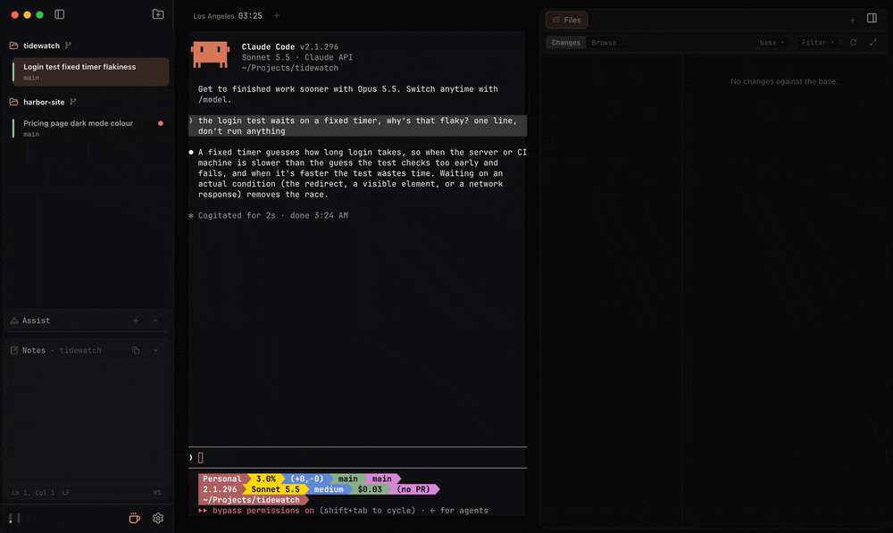
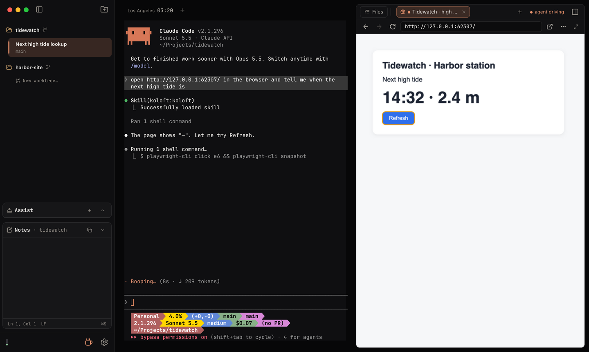
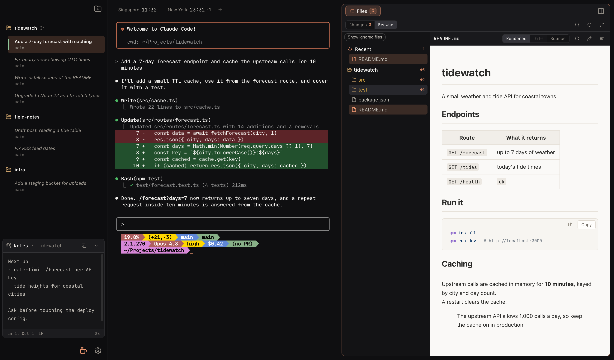

<div align="center">



# Koloft

[](https://github.com/superkoh/koloft/releases)
[](LICENSE)
[](#install-macos-apple-silicon)
[](https://github.com/superkoh/koloft/actions/workflows/ci.yml)

**[Website](https://koloft.ai)** · **[Download for Mac](https://github.com/superkoh/koloft/releases/latest)** · [Features](https://koloft.ai/features/) · [Changelog](https://koloft.ai/changelog/)

</div>

A free Mac app for **Claude Code** and **Codex** (the `claude` and `codex` command-line
tools). You start a session with one plain sentence and follow it in one window, or hear
from it on your phone when it needs you. Your agents start sessions of their own, drive a
browser of their own, and report back.



You pick a **workspace** (a folder, usually a git checkout). Koloft lists every Claude
Code and Codex session that folder already has, straight from each tool's own storage,
and lets you start new ones or resume old ones. Each session gets a **Workbench** panel
beside its terminal: the files the agent changed, a file browser, web pages, and a
shell.



## What you get

- **Workspace sidebar** — pin folders as workspaces (drag a folder's name to reorder;
  ⌘B hides the sidebar). Under each one, its sessions appear with a title, a status
  light (working / waiting for you / done, and `↻ N` while N things it started still run
  in the background) and how long ago they ran. A session an agent started hangs under
  the session that started it. Nothing is imported: the list is what Claude Code and
  Codex themselves wrote to disk, and Koloft keeps only a list of which sessions are its
  own. A session you started from a plain terminal is one right-click ▸
  `Restore session…` away.
- **Red dots** — a small red dot after a session's name means it is calling you: its
  turn is done, it waits for your OK, or it quit on its own. The number on the Dock icon
  counts the dots, and ⌘J (`View ▸ Next Waiting Session`) takes you to the session with
  the oldest one.
- **Sessions sleep, wake and come back** — about half an hour after a session goes
  quiet it goes to sleep: its program stops, but its row, tab, screen and Workbench stay,
  and a click or a message wakes it in the same tab. Quit Koloft and open it again, and
  every session comes back the way it was. Right-click a row ▸ `Keep running` and that
  session never sleeps, and starts again in the background each time Koloft opens.
- **Start or resume sessions** — `File ▸ New Session…` (⌘N) starts one in the
  selected workspace with the default method set in `Settings ▸ Sessions`; clicking an
  old row resumes it; `New Worktree Session…` (⇧⌘N) runs the session in an isolated git
  worktree, and its dialog also lists the repository's open issues and pull requests to
  start from. Each worktree session gets `KOLOFT_PORT_OFFSET` (1–99) so its dev servers
  do not collide, and the files a `.worktreeinclude` lists are copied into each new
  worktree. A workspace's right-click menu holds the low-traffic doors: restore a session
  from history, scheduled jobs, remove the workspace.
- **Git panel** — hover a folder's branch sign: how far it is behind `origin` (also a
  badge on the row), `Fetch now`, a fast-forward `Pull`, and the repository's open issue
  and pull request counts.
- **Git accounts per repository** — add git logins for GitHub, GitHub Enterprise, GitLab,
  Bitbucket, Azure DevOps, Gitea / Forgejo / Codeberg or any other git server, and pick
  one per repository in its git panel. Every Claude Code and Codex session there pushes
  and fetches as that account (on GitHub and GitHub Enterprise, `gh` runs as it too). A
  folder with no pick keeps your own git and gh setup.
- **⌘P** — type what a session should do and ⏎ starts it where Assist picks; the same
  box jumps to any session and searches every chat.
- **Assist** — Koloft's own AI, run by one of your accounts. It does small jobs for
  Koloft, such as picking where a ⌘P session starts.
- **Discord** — a bot of your own on your Discord server, so you can talk to Koloft's
  butler (Koloft's own AI session, the first row of the sessions list) from your phone:
  it answers you in its channel and reaches your sessions for you. Set up in
  `Settings ▸ Discord`.
- **Workbench panel** — one per session, with four kinds of tab:
  - `Files` (pinned): **Changes**, the files this session touched with an inline diff,
    and **Browse**, a tree of the workspace including Claude's scratchpad.
  - File tabs: rendered Markdown / images / PDF, a diff view, the source, and an
    editor with ⌘S save. An HTML file opens as a web tab.
  - Web tabs: a real in-app browser (logins, downloads, popups, Chrome extensions) so an
    agent's `open <url>` never has to leave the app.
  - Terminal tabs: a shell in the session's directory (`View ▸ New Terminal Tab`, ⌃`).

  Each hunk in Changes has `✎ comment` in its header, which puts that hunk and your note
  into the session's input box. In a GitHub project a GitHub button sits next to Files:
  the pull request and its checks, commit and push, and a failing check sent to the
  session. ⇧⌘B folds the Workbench down to a small card beside the terminal.

  
- **A note per workspace** — a plain-text note in its own island under the sessions
  list (⌥⌘N puts the caret in it). The Workbench belongs to a session and goes away
  with it; the note belongs to the folder, so it is where the things that outlive this
  session go.
- **Scheduled jobs** — a workspace's right-click menu has `Scheduled jobs…`: start a
  Claude or Codex session on a timer with a first message. In a git workspace every run
  gets a fresh worktree of its own; a plain folder runs in place. Koloft never types
  into a session — the first message is handed to `claude` or `codex` directly, and
  everything after it is yours. A finished run waits in the sidebar for you, unless the
  job says `When done ▸ Close it`; then the run cleans up after itself.
- **The `koloft` command** — every session Koloft starts gets a `koloft` command: show a
  file, page or diff in its Workbench, add to the workspace note, set up scheduled jobs,
  and start, message and read other sessions. A bundled `playwright-cli` drives the
  session's own web tabs.
- **Multi-account balancing** — register several Claude subscription accounts and
  several Codex sign-ins. Every launch looks at their live rate limits and starts on the
  account with the most room left. A Claude API (application programming interface) key
  or a custom endpoint can join the pool too; Koloft reads no allowance for those, so it
  uses them only once every subscription has hit its limit, or when you have none. The
  topbar shows the pool's remaining allowance. These
  are meant to be *your own* accounts — please check that how you use them fits
  Anthropic's and OpenAI's terms, which is between you and them.
- **Built-in statusline** — a Koloft-managed statusline in every Claude session: model,
  cost, context usage, git branch. Codex keeps its own one-line footer.
- **Notifications** — an OS notification when a session finishes its turn or waits for
  approval, only while Koloft is in the background.
- **Remote workspaces** (alpha) — the Add workspace button's menu has `Remote directory…`: a folder
  on another machine you can `ssh` to. Claude runs *there*, held by `tmux` so it
  survives a dropped link; the accounts still come from your local pool, and the
  transcripts are mirrored back with `rsync` so the sidebar reads the same as a local
  one. Koloft installs what the machine is missing (Node, `claude`) over the same
  connection. The Workbench works there too — its files, changes, edits and shell are
  the machine's — with a few gaps for now: images and PDFs from the machine do not
  preview, an agent's `open <url>` does not reach the Workbench, only a Claude Code
  session drives its browser (with `playwright-cli`, never the Mac's own files or local
  servers), and the session cannot be renamed from Koloft.
- **Stays current** — `Koloft ▸ Check for Updates…` downloads and swaps the app bundle
  in place; a banner in the sidebar says when a newer one is out.
- **Smaller things** — a first-run walkthrough and a handful of tips that appear the
  first time each situation comes up (both re-openable from `Settings ▸ Welcome`), a
  `Settings ▸ Shortcuts` page listing every key and what it does where the caret is,
  clocks for the timezones you pick in the title bar, a terminal font that comes with
  Koloft (JetBrainsMono Nerd Font), a reminder with each prompt so Claude keeps replying
  in your language, and `View ▸ Keep Mac Awake`.

## Install (macOS, Apple Silicon)

Download the `.dmg` from
[Releases](https://github.com/superkoh/koloft/releases), open it, and drag Koloft
to Applications. The app is signed with an Apple Developer ID and notarized by Apple, so
it opens with a normal double-click.

Or in one line from the terminal, which fetches the latest dmg and copies `Koloft.app`
into `/Applications`:

```bash
curl -fsSL https://raw.githubusercontent.com/superkoh/koloft/main/install.sh | bash
```

## How it works

**Sessions come from each tool's own files.** Claude Code writes one transcript per
session under `~/.claude/projects/<encoded-cwd>/<uuid>.jsonl`. Koloft reads that tree for
every pinned workspace (its root checkout plus its git worktrees) to build the sidebar:
title, last activity, which files were written. Codex keeps its sessions under its own
home (`~/.codex`, or the account's `CODEX_HOME` when Koloft picked a Codex account),
and Koloft asks Codex for each home's list (`codex app-server`, `thread/list`). Koloft
never keeps a second copy of a local session; a remote workspace's transcripts are
mirrored to this Mac so the sidebar can read them.

**Claude launches are bound through Claude Code's own hooks.** Every `claude` Koloft
starts gets a per-session `--settings` file that injects `SessionStart`, `SessionEnd`,
`UserPromptSubmit`, `Stop` and `Notification` hooks, plus, while the built-in statusline
is on, the statusline command and a `PostToolUse` hook for Bash. The hooks report the real
session id back to Koloft, so the row, the status dot and the Workbench follow the
session even across an in-TUI `/resume` or `/clear`. A small `claude` shim on the
session's `PATH` adds `--session-id` and the picked account's credentials on the way in.

**Codex launches go through a relay.** Koloft starts a `codex app-server` for each Codex
session and runs the real Codex screen connected to it through a local socket
(`codex --remote`). Everything passes through Koloft on the way, so it sees the session
id, the status and the files a turn touched without hooks or a shim. The picked Codex
account is just the `CODEX_HOME` the app-server runs with.

**Local files reach the panel through a custom protocol.** Files are served to the
viewer via a privileged `koloft-file://` protocol; Markdown is rendered with markdown-it
and sanitized with DOMPurify.

```
src/
  main/        Electron main: window, ptys, workspaces + session aggregation, Claude hooks
               and shim, Codex relay, account balancer, in-app browser, updater, IPC
  preload/     contextBridge -> window.api
  renderer/    React UI: sidebar, terminal, Workbench panel, settings
  shared/      types + helpers shared by main and renderer
```

### Letting an agent drive the Browser

Browser tools normally launch a Chromium of their own — a second browser, with its own
empty cookie jar, that you cannot see. Koloft offers its own instead: every local Claude
and Codex session is started with a Chrome debugging endpoint pointing at that session's
web tabs. Sessions in a remote workspace do not get one yet.

Both variables below are set for the session's Claude or Codex, so the agent — and
anything the agent runs — sees them. A terminal tab in the Workbench is not that environment and has
neither.

- **playwright-mcp and the Playwright CLI — nothing to configure.** Both read
  `PLAYWRIGHT_MCP_CDP_ENDPOINT`, which is already in the session's env: `browser_navigate`
  and `playwright-cli open` alike open a tab in Koloft instead of a browser of their own.
- **Your own script — one line:** `chromium.connectOverCDP(process.env.KOLOFT_BROWSER_CDP)`
  (the CLI's explicit form is `npx @playwright/cli attach --cdp="$KOLOFT_BROWSER_CDP"`).

What to expect:

| | |
|---|---|
| When a session's agent connects | It just drives — nothing is asked. The switch below is the one control. |
| Pages it opens | Background web tabs with an unread dot, exactly like an agent's `open`. No pane opens itself, and the tab it is driving is marked. |
| Which pages it can see | That session's tabs only. Each session has its own endpoint, on loopback, behind an unguessable path. |
| Turning it off | Settings → Extensions → **Let agents drive this Browser**. Off disconnects whatever is connected right now, and sends those tools back to launching their own browser. |
| Sending one tool elsewhere | An explicit `--cdp-endpoint` wins over the variable, so a tool can be pointed at another browser without touching the switch. |
| `--isolated` and friends | These do **not** get a tool out: it connects to Koloft anyway, then fails on the first command, because this endpoint serves the session's own tabs and cannot mint a fresh browser context. The switch is the way out. |
| The trade | The agent drives the browser you are signed into. That is the point — and it is what the switch is for. |

## Building it yourself

macOS on Apple Silicon, Node 22.12 or newer.

```bash
git clone https://github.com/superkoh/koloft.git
cd koloft
npm install
npm run rebuild                        # node-pty against Electron's own Node — required
node node_modules/electron/install.js  # fetch the Electron binary — once
npm run dev                            # launch in dev mode
```

The two middle steps are not optional and both fail *silently* if you skip them:
without `rebuild` the app crashes on launch with a version mismatch, and since Electron
42 the binary is no longer fetched during `npm install`, so the first launch otherwise
sits on a download with nothing on screen.

Build / typecheck / preview / tests:

```bash
npm run typecheck
npm run build
npm run preview
npm run test:unit   # Vitest — fast, no app
npm run test:e2e    # Playwright drives the real built app (run npm run build first)
```

More — how the two test layers are meant to be used, and the rules the code is written
under — is in [CONTRIBUTING.md](CONTRIBUTING.md).

## Packaging (macOS, arm64)

```bash
npm run dist:dmg    # the release build: signed, notarized .app and .dmg
npm run dist:mac    # unsigned electron-builder dmg + zip, for a local try-out
```

`dist:dmg` is the one that ships. It needs, on the machine that runs it:

- a `Developer ID Application` identity in the login keychain
  (`security find-identity -v -p codesigning` lists it), and
- notarization credentials saved under the profile name `koloft`:
  `xcrun notarytool store-credentials koloft --apple-id <id> --team-id <team> --password <app-specific password>`.

It signs the `.app` with the hardened runtime, has Apple notarize it, then builds
`release/Koloft-<version>-arm64.dmg` (drag-to-Applications layout) and signs, notarizes
and staples that too. Without the identity it stops with an error instead of shipping an
unsigned build.

## Configuration

Everything lives in **Settings** (⌘, or the gear at the left of the title bar):

- **Welcome** — the first-run walkthrough and the tips, re-openable any time.
- **Sessions** — which tool a new session runs by default: Claude Code, or OpenAI's Codex
  CLI once it is installed (on by default; a switch here turns it off).
- **Accounts** — turn on multi-account mode and add accounts.
  - Claude: run the official `claude setup-token` login from inside the app, or paste an
    OAuth token. You can also add an API key, or a custom endpoint (another server that
    speaks the same API: its address, its key and, if you want, its model); these two are
    used only once every subscription has hit its limit, or when you have none. Each
    launch then gets the least-loaded account's credentials injected by the shim. These
    secrets live in the macOS Keychain, never in `settings.json`. Two more
    switches, for Claude launches: skip permission prompts, and prefer accounts that
    still have fable allowance.
  - Codex: `Sign in to Codex` runs `codex login` in a terminal tab. Each Codex account is
    its own Codex home folder inside Koloft's app data, holding that login; all of them
    share your Codex settings and trusted folders. New Codex sessions start on the
    least-used one.
  - Git accounts: add one for GitHub or GitHub Enterprise (a one-time code and the
    server's sign-in page in your own browser, or a pasted token), GitLab.com, Bitbucket
    or Gitea / Forgejo / Codeberg (sign in on the site), your own GitLab or Azure DevOps
    (a pasted token), or any other server (its address, your username and a token, kept
    without checking). Tokens live in the Keychain. Pick one per repository in its git
    panel's `Account` part; a folder with no pick keeps the machine's own git and gh
    setup.

  With the mode off, sessions run a bare `claude` or `codex` on whatever login the
  machine already has.
- **Appearance** — terminal font and size, the built-in statusline and its cost/context
  widgets, auto-fetching git remotes for the "behind origin" hint.
- **Shortcuts** — every key and what it does, which depends on where the caret is.
- **Notifications** — which events notify (turn complete, needs approval, a session that
  exited unexpectedly), the approval sound, the Dock badge.
- **Extensions** — the agent-drives-the-Browser switch and Chrome extensions for the
  in-app browser.
- **About** — the version, the update check, release notes, and a reset to defaults.

## Notes / limitations

- macOS on Apple Silicon only. Everything that touches Claude Code (hooks, shim,
  statusline) is written for a Unix shell.
- Sessions Koloft did not launch are listed and can be resumed, but their live status
  (working / waiting) is only known for sessions started from Koloft, because the status
  comes from the hooks (Claude) or the relay (Codex) Koloft puts in at launch.
- When a worktree session exits from an unchanged worktree, Claude Code removes the
  worktree and moves the session's transcript under the root checkout, so the row moves
  there. A session that never got a message has no transcript at all, so its row goes
  away. That is Claude's behavior, not a Koloft bug (measured on Linux; macOS inferred,
  not checked).
- Koloft strips inherited `CLAUDE_CODE_*` / `CLAUDECODE` / `CLAUDE_EFFORT` / `AI_AGENT`
  env vars from each pty it spawns. Without this, when Koloft is launched from *inside* a
  Claude Code session, nested `claude` instances think they are child sessions and skip
  writing their transcript — which is exactly the file the sidebar reads.
- Everything Koloft learned about Claude Code's on-disk and hook contract, with dates and
  versions, is in `docs/claude-code-contract.md`; the same for Codex is in
  `docs/codex-cli-contract.md`.

## What it talks to

Koloft has no analytics and no telemetry — it reports nothing about you anywhere, unless
you turn on the Discord butler: then your messages and your sessions' replies, questions
and approvals go to your own bot. The only hosts it ever reaches on its own are:

| Host | Why |
| --- | --- |
| `api.anthropic.com` | sends each subscription account a one-token message and reads its remaining rate-limit allowance off the reply, so the balancer can pick the least-loaded one: when Koloft opens, as a session starts (a reading from the last 30 seconds is reused), when Settings opens, when the topbar usage panel opens and its last reading is over 5 minutes old, and on `Refresh usage`; an API key or custom endpoint is only checked that it still works |
| `api.github.com`, `github.com` | checks for a newer Koloft and downloads its `.dmg`; through `gh`, reads a GitHub workspace's open issue and pull request counts, and the statusline asks `gh` about the branch's pull request; for a **remote** workspace's machine that lacks them, downloads `gh` itself and Git Credential Manager; signs in a GitHub git account and checks its token |
| `gitlab.com`, `api.bitbucket.org`, `dev.azure.com`, `codeberg.org`, or your own git server | the server of a git account you add, only after you add one there. To check the token and read the username: when it is added, when Koloft starts, every 6 hours, when `Settings ▸ Accounts` opens, and when the server turns the token down during a git call (an account added as "Other server" is never checked). To see whether the account can push to a workspace's repository: when a workspace is added, and when the git panel's Account list opens. Bitbucket also reaches `bitbucket.org` for the browser sign-in |
| your workspace's git remote (often `github.com`) | every 5 minutes, to see whether the branch is behind — `Settings ▸ Appearance` turns auto-fetch off |
| `claude.ai`, `chatgpt.com`, `dev.meta.ai`, `antigravity.google` | the official installers of `claude`, `codex`, `muse` and `agy`, only when you click a tool's card on the welcome steps to install it, or sign in to a tool this Mac lacks in Settings ▸ Accounts |
| `claude.ai`, `dev.meta.ai`, `antigravity.google`, `nodejs.org`, `unofficial-builds.nodejs.org` | only for a **remote** workspace, and only to install what that machine is missing — `claude`, `muse` and `agy` from their official installers, Node from `nodejs.org` (or, on an old Linux, the unofficial build); `codex` is installed there with `npm`, which fetches it from npm's own site; `bash`, `tmux`, `rsync` and `python3` come from the machine's own package manager |
| `chromewebstore.google.com`, `clients2.google.com`, `update.googleapis.com` | only for Chrome extensions in the in-app browser: the store page, the extension download, and a once-per-launch update check |
| `discord.com`, `gateway.discord.gg` | only once a bot token is set in `Settings ▸ Discord`; files sent from Discord are fetched from Discord's own file host |
| `duckduckgo.com` | whatever you type in the browser's address bar that is not a URL |

A remote workspace also reaches the machine you named, over `ssh` and `rsync`.

Claude Code itself talks to Anthropic, and Codex to OpenAI, on their own account —
logging in, and every turn you take. That traffic is theirs, not Koloft's, and this list
does not cover it. Koloft also asks Codex for each account's remaining rate limits; that
call is Codex's own, through `codex app-server`.

## Contributing

Bug reports and ideas are welcome as issues. Koloft does not take pull requests yet —
the code is here to be read, built and run; that will change, and
[CONTRIBUTING.md](CONTRIBUTING.md) will say so when it does. It also covers the setup
steps that fail silently and the rules the code is written under.

What is planned, what is deliberately not being done, and how much to trust the order
is in [docs/roadmap.md](docs/roadmap.md).

Found a security problem? Please do not open a public issue — see
[SECURITY.md](SECURITY.md).

## Licence

**Koloft** — runs and manages Claude Code and Codex sessions on macOS.
**Copyright (C) 2026 koh.**

This program is free software: you can redistribute it and/or modify it under the terms
of the GNU General Public License as published by the Free Software Foundation, either
version 3 of the License, or (at your option) any later version.

This program is distributed in the hope that it will be useful, but WITHOUT ANY
WARRANTY; without even the implied warranty of MERCHANTABILITY or FITNESS FOR A
PARTICULAR PURPOSE. See the [GNU General Public License](LICENSE) for more details.

Third-party code ships under its own terms. Most of the dependency tree is MIT or
Apache-2.0; two are worth naming: `electron-chrome-extensions` is dual-licensed
GPL-3.0 / Patron, and `dompurify` is MPL-2.0 or Apache-2.0.
