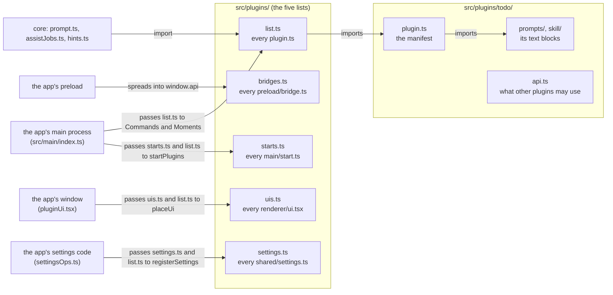
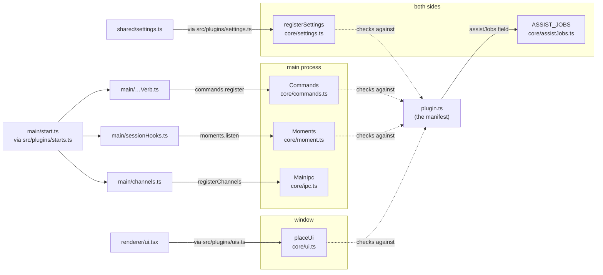

# Koloft plugin format

Format version 1. Only plugins built into Koloft exist.

This page says what a Koloft plugin is, what its manifest (the plain-data file that says what
the plugin is and what it owns) contains, and how a plugin's code plugs into Koloft. It is
written for someone who has not read Koloft's code. The decision behind the format is
[ADR-0051](adr/0051-a-plugin-owns-its-feature-and-core-names-none.md) (an architecture
decision record). A number such as #1985 is an issue in
[superkoh/koloft](https://github.com/superkoh/koloft/issues) on GitHub; the issue says whether
it is done.

- A plugin is one feature of Koloft as one piece. It is a folder, `src/plugins/<id>/`, with
  its manifest in `plugin.ts`.
- A plugin's code registers its `koloft` commands, its IPC channels, its settings, its UI
  entries and the session moments it listens to with core
  ([How a plugin plugs in](#how-a-plugin-plugs-in)). Its main-process registrations happen in
  one start function, which the main process calls once at launch
  ([Starting](#starting)). Each registration is checked against the manifest: by the code
  that takes it, which throws an error, or by a unit test.
- An optional plugin has a switch in Settings ▸ Plugins. Turning it off takes its text,
  commands, moments, UI and running parts away ([Switches](#switches)).
- The shape of the manifest and of what a plugin registers through is pinned for format
  version 1. Changing it fails Koloft's typecheck until the change is pinned or the version
  goes up ([Format version](#format-version)).
- A change that adds a registration (a moment, a slot, a UI entry, a command, a setting) or
  changes a pinned shape updates this page, and the pin in `test/unit/pluginFormat.test.ts`,
  in the same pull request; that test fails until it does.
- A plugin imports only core, its own folder, and the `api.ts` or `windowApi.ts` of plugins it
  says it needs. Much code does not follow this rule yet; a check lists each case
  ([The import rule](#the-import-rule)).
- Installing a plugin from outside Koloft, isolation and permissions are not built
  ([Not built or not decided](#not-built-or-not-decided)).

## Words used on this page

- **Session**: one run of a coding agent (Claude Code, Codex or Antigravity) that
  Koloft starts in a terminal tab.
- **Owner**: the person using Koloft.
- **Butler**: a long-running session that watches the other sessions for the owner.
- **Workbench**: the panel beside each session tab: its changed files, a file browser, web
  pages and a shell. Each workspace has one too, without the shell.
- **Skill**: a set of instructions an agent loads when a task needs it. The `koloft` skill
  tells an agent how to use the `koloft` command, which an agent runs to ask Koloft for
  things.
- **Assist job**: a small AI task Koloft runs on its own, such as naming a new session.
- **Main process** and **window**: Koloft is an Electron app. Its main process runs the
  sessions and talks to the system; its window draws the screen. A **preload** is the small
  script that hands the window `window.api`, the functions it may call in the main process.
- **IPC channel** (inter-process communication): one named message between the main process
  and the window, such as `cron:list`.
- **⌘P**: Koloft's command palette, a box where the owner types words or picks an action.
- **Core**: the code in `src/core/`, which the app and every plugin use. It is not a plugin.
  ("Sessions core" is the name of a plugin, `sessions`.)

## What a plugin owns

A plugin owns six things. The example column says what the Discord plugin owns. All of
Discord's code is in its folder; its start builds its main-process parts, and
`src/main/index.ts` hands them what they need from the rest of the app.

| # | A plugin owns | Manifest field | Example (Discord) |
|---|---|---|---|
| 1 | Text for agents: parts of the butler's prompt, of every session's prompt and of the `koloft` skill | `text`, `skills` | the Discord part of the session prompt |
| 2 | `koloft` commands | `commands` | `koloft discord …` |
| 3 | Session moments it announces or listens to | `moments` | a file was opened; a turn ended |
| 4 | Settings, with its own settings page | `settings` | the bot and the bound channel; Settings ▸ Plugins ▸ Discord |
| 5 | UI entries (things on screen) | `ui` | the dialog that binds a channel |
| 6 | Code, in its own folder | none: the code lives in the folder | `src/plugins/discord/` |

A plugin also says what it does in one line, whether it is mandatory, and which plugins it
needs. It may also list its Assist jobs (`assistJobs`), its IPC channels (`channels`), its
tips (`hints`) and MCP servers (`mcpServers`: Model Context Protocol servers, which give an
agent extra tools).

Code never goes into the manifest. A plugin's running code lives in its own `main/`,
`preload/`, `renderer/` and `shared/` folders, where it registers itself. So Koloft can read
what a plugin owns (for a settings page, help text or a switch) without running the plugin.

## The plugins

These are the plugins in `src/plugins/list.ts`, in its order. A plugin is listed after
every plugin it needs. The order also decides the order of text blocks that fill the same
slot, of UI parts in one place, of listeners to one moment, and of Assist jobs.

| Id | Name | Mandatory | Needs |
|---|---|---|---|
| `sessions` | Sessions core | yes | — |
| `workbench` | Workbench | yes | — |
| `browser-control` | Browser control | yes | `workbench` |
| `butler` | Butler | yes | `sessions` |
| `inbox` | Inbox | yes | `sessions` |
| `scheduled-tasks` | Scheduled tasks | yes | `sessions` |
| `github` | GitHub | no | `sessions` |
| `discord` | Discord | no | `butler` |
| `todo` | Todo | no | `sessions`, `butler`, `github` |
| `passwords` | Passwords and sign-in | no | `sessions`, `workbench` |
| `docs-writing` | Docs writing | no | — |

This table says what each plugin's manifest fills today. The moments each plugin announces and
hears are in [Moments](#moments).

| Plugin | `commands` (`koloft …`) | `channels` | `settings` keys | `ui` entries | `assistJobs` |
|---|---|---|---|---|---|
| Sessions core | `help`, `session`, `workspace`, `instructions` | yes | — | — | `title`, `handover`, `turn` |
| Workbench | `open`, `diff`, `note` | yes | — | — | `docs` |
| Browser control | — | yes | `browserControl`, with a page | 1 | — |
| Butler | — | yes | `butler`, `butlerSession`, `ownerAsleepSince`, with a page | 8 | `route` |
| Inbox | `inbox` | yes | — | 2 | — |
| Scheduled tasks | `cron` | yes | — | 2 | — |
| GitHub | `gh` | yes | — | — | — |
| Discord | `discord` | yes | `discord`, with a page | 2 | — |
| Todo | `todo` | — | `todoNotes` | — | — |
| Passwords and sign-in | `secret`, `page` | yes | — | — | — |
| Docs writing | — | — | — | — | — |

GitHub also lists one tip, `github` ([Tips](#tips)), and Discord sets `offUntilSetUp`
([Switches](#switches)). Docs writing has its manifest and an `api.ts` that says whether it is
on; the app hands its `koloft-docs` skill to agents only while it is.

## Where a plugin lives

Each plugin is one folder under `src/plugins/`, named by its id. Five list files sit next to
the folders. They are the only files outside the plugin folders that may import a plugin,
and each imports one kind of file from each plugin. The picture shows who reads which list.



### The five lists

| File | What it holds |
|---|---|
| `src/plugins/list.ts` | `PLUGINS`, every manifest in order |
| `src/plugins/bridges.ts` | `pluginBridges(ipc)`, which joins every plugin's part of `window.api`; `PluginBridges`, its type; and `KoloftApi = CoreApi & PluginBridges`, the type of `window.api` |
| `src/plugins/uis.ts` | `PLUGIN_UIS`, each plugin's UI parts and slot fills, keyed by plugin id |
| `src/plugins/settings.ts` | `PLUGIN_SETTINGS`, each plugin's setting keys, keyed by plugin id; the type of the plugins' settings comes from it |
| `src/plugins/starts.ts` | `PLUGIN_STARTS`, each plugin's start function, keyed by plugin id in list order; `PluginStartDeps`, what the app hands each one; and `PluginsStarted`, what each one gives back ([Starting](#starting)) |

### Core

These files in `src/core/` are what plugins build on. The first ten are the registries and
the types a plugin registers with.

| Path | What it holds |
|---|---|
| `src/core/plugin.ts` | the manifest type `PluginManifest`, `PLUGIN_FORMAT_VERSION` and `eachAgent` |
| `src/core/prompt.ts` | `composePrompt` and `fillSlots`, which put text blocks together ([Text blocks](#text-blocks)) |
| `src/core/commands.ts` | `Commands`: the registry of `koloft` commands ([Commands](#commands)) |
| `src/core/command.ts` | what a `koloft` command answers with: `answered`, `refused`, `EXIT_USAGE`, `NOT_PINNED`, `splitAtDashes`, `fail`, `cutForATurn` and their types; `AGENT_SHIM_WAITS_MS`, how long a `koloft` command waits for Koloft's answer |
| `src/core/ipc.ts` | `MainIpc` (`handle`, `on`, `onEvent`, `push`) and `PreloadIpc` (`invoke`, `send`, `sendSync`, `listen`): how a plugin's code registers and uses its own IPC channels ([IPC channels](#ipc-channels)) |
| `src/core/settings.ts` | `setting`, `registerSettings` and `settingsPages` ([Settings](#settings)) |
| `src/core/ui.ts` | `slot`, `fill`, `PluginUi` and `placeUi` ([UI entries and slots](#ui-entries-and-slots)) |
| `src/core/assistJobs.ts` | `ASSIST_JOBS`, every plugin's Assist jobs in list order, and `assistJobDefaults` ([Assist jobs](#assist-jobs)) |
| `src/core/moment.ts` | the named session moments, the shape each carries, and `Moments`, the registry plugins listen through ([Moments](#moments)) |
| `src/core/pluginStart.ts` | `PluginCore`, what a start function is handed; `PluginStart`, the type of a start function; and `startPlugins`, which calls them ([Starting](#starting)) |
| `src/core/switches.ts` | `pluginStates`, `pluginStateOf` and `turnedOffLine`: which plugins are on ([Switches](#switches)) |
| `src/core/hints.ts` | `HINT_IDS`, `hintOn` and `tipNumber`: the app's tips and the plugins' ([Tips](#tips)) |
| `src/core/assistModels.ts` | the `ModelAndEffort` type, the model tables Assist jobs share (such as `SMALL_AND_QUICK`), and the `AssistJob` and `Assist` types, so a plugin can take Assist as a function |
| `src/core/presence.ts` | `OwnerPresence`: where the owner is. `where()` answers `at-the-mac`, `away` or `asleep`, and `listenToSleep` tells a plugin when the night starts and ends. A plugin asks it and never works this out itself |
| `src/core/ownerWaits.ts` | `OwnerWaits`: a plugin marks a session as waiting on the owner, and clears that mark, with no other way to reach the attention marks |
| `src/core/ownerInstructions.ts` | the versions of the owner's Instructions, the edits an agent may propose to them, and the one way a list of versions is saved under a byte limit, by the owner or by an agent the owner agreed with |
| `src/core/webPage.ts` | `WebPage`: one Workbench web page a plugin may run a script in |
| `src/core/gh.ts` | what running `gh` gives back, for core and plugins alike: `GhResult`, `Gh`, `GH_SIGNED_OUT`, `slug`, `ghJsonArray`, and the shape of the GitHub fixture that Koloft's end-to-end tests use (`GithubFixture`) |
| `src/core/worktree.ts` | `GitOut`, `branchExists` and `TidyResult`, for the worktree git helpers |
| `src/core/typeKeys.ts` | `typeKeys`, `pressesAKey`, `clicksTheMouse` and their helpers: what Koloft types into a session's terminal |
| `src/core/transcriptPlaces.ts` | `TranscriptPlaces`: where a session's transcript is, on this Mac or on its machine |
| `src/core/agent/` | what is the same for every agent: the agent ids and the two defaults from the list of agents (`registry.ts`), the manifest type (`manifest.ts`), the session interface `SessionBackend` with its registry `SessionBackends` (`sessionBackends.ts`), and a session's run state, `SessionRuntime` and `envMs` (`sessionRuntime.ts`) |
| `src/core/scheduleLabel.ts` | `scheduleLabel` and `wakeupItem`: the label of a timer or scheduled task a session is waiting on |
| `src/core/privateFile.ts` | `PrivateRecordFile`: a JSON record file only the owner can read |
| `src/core/unknownValue.ts` | `record` and `nonEmptyString`: read a value of unknown shape as an object or as a string that is not empty |
| `src/core/thisMacsServers.ts` | `namesThisMacsServer` and `reachesThisMacsServer`, whether a web address reaches a server on this Mac |
| `src/core/openDrop.ts` | `openDropTarget` and `openDropHandler`, the file or address an `open` request names |
| `src/core/isUnderAnyRoot.ts` | `isUnderAnyRoot`, whether a path sits inside one of some folders |
| `src/core/ownerWords.ts` | `OWNER_QUOTE_MARKS`, the marks put around the owner's own words |
| `src/core/errorText.ts` | `errorText`, the text of a thrown error |
| `src/core/terminalCodes.ts` | `stripTerminalCodes`, text without terminal control codes |
| `src/core/coalesce.ts` | `coalesce`, which runs one piece of work per key at a time and joins calls that come meanwhile |
| `src/core/mapAtMost.ts` | `mapAtMost`, a map that runs at most so many at once |
| `src/core/within.ts` | `within`, a promise that gives up after so many milliseconds |
| `src/core/sleep.ts` | `sleep(ms)` |

### Inside a plugin folder

A plugin folder holds these files and folders. The last column says which plugins have one
today.

| Path | What it holds | Today |
|---|---|---|
| `plugin.ts` | the plugin's manifest | all |
| `prompts/` | its text blocks for prompts | sessions, browser-control, butler, github, discord, todo |
| `skill/` | its text blocks for `koloft help` and the `koloft` skill | all but butler and docs-writing |
| `api.ts` | what other plugins may import | all but inbox and scheduled-tasks |
| `windowApi.ts` | what other plugins' window code may import: the part of its public surface with no main-process code and no text for agents. It may not import its own `main/` or `prompts/` | butler |
| `main/` | code that runs in the main process; `start.ts` there is its start function | all but docs-writing |
| `preload/` | `bridge.ts`, its part of `window.api` | all but todo and docs-writing |
| `renderer/` | code that runs in the window; `ui.tsx` there is its UI parts and slot fills | browser-control, butler, inbox, scheduled-tasks, github, discord, passwords |
| `shared/` | code the main process and the window both use; `ipc.ts` there is its table of IPC channels, `settings.ts` its setting keys, `assistJobs.ts` its Assist jobs | all but docs-writing |

Koloft has two type checks. The main-process one reads every plugin folder except
`renderer/` folders and `src/plugins/uis.ts`. The window one reads every plugin folder except
`main/` folders and `src/plugins/starts.ts`. Both read `preload/` and `shared/`. A `preload/` file imports no
`electron`; it gets a `PreloadIpc`.

## The manifest

A manifest is a TypeScript file that exports one object named `plugin`. This is the whole
manifest of the Todo plugin:

```ts
import { PLUGIN_FORMAT_VERSION, type PluginManifest } from '@core/plugin'
import { TEXT } from './prompts/text'

export const plugin: PluginManifest = {
  formatVersion: PLUGIN_FORMAT_VERSION,
  id: 'todo',
  name: 'Todo',
  does: 'koloft todo: {{butler-name}} works through a list of GitHub issues for you.',
  mandatory: false,
  needs: ['sessions', 'butler', 'github'],
  settings: { keys: ['todoNotes'] },
  commands: [{ verb: 'todo' }],
  text: TEXT
}
```

`@core/` and `@plugins/` are path shortcuts for `src/core/` and `src/plugins/`.

### Required fields

| Field | Type | Meaning |
|---|---|---|
| `formatVersion` | the number `1` | the format version this manifest is written for |
| `id` | string | the plugin's id; equal to its folder name |
| `name` | string | the name a person sees, such as `Passwords and sign-in` |
| `does` | string | one line a person reads in Settings ▸ Plugins and at the top of the plugin's page; `{{butler-name}}` stands for the butler's name |
| `mandatory` | boolean | `true`: the plugin has no switch and is always on |
| `needs` | list of plugin ids | the plugins this plugin needs; turning one of them off turns this one off too |

The unit test `test/unit/pluginList.test.ts` holds these rules:

- Each folder under `src/plugins/` has exactly one manifest on the list, and its `id` is the
  folder name.
- Each plugin comes after every plugin it needs on the list. So no plugin needs itself, no
  two plugins need each other, and every id in `needs` is on the list.
- A mandatory plugin needs only mandatory plugins.
- No two Assist jobs share an id, and none is `butler`.

There is no other naming rule for an id.

### Optional fields

Each optional field is a place for one of the things a plugin owns. The last column says
what reads the field today.

| Field | Type | Meaning | Read by |
|---|---|---|---|
| `offUntilSetUp` | a setting key | an optional plugin that starts off while this setting still holds its default; the owner's choice wins once made ([Switches](#switches)) | `pluginStates` |
| `text` | list of `TextBlock` | text the plugin adds to agents' prompts ([Text blocks](#text-blocks)) | `composePrompt`, `fillSlots` |
| `slotsEachAgentFills` | list of slot names | the slots the plugin leaves in its text for each agent to fill with its own words ([Text blocks](#text-blocks)) | `fillSlots` |
| `commands` | list of `{ verb }` | each `koloft <verb>` command the plugin owns ([Commands](#commands)) | `Commands` |
| `channels` | list of strings | the IPC channels the plugin's code uses, written `Object.values(CHANNELS)` ([IPC channels](#ipc-channels)) | the unit test `test/unit/ipcChannels.test.ts` only |
| `moments` | `{ announces?, listens? }`, each a list of moment names | the session moments the plugin announces and those it hears ([Moments](#moments)) | `Moments` |
| `settings` | `{ page?: { label, words }, keys }` | the setting keys it owns, and its settings page if it has one ([Settings](#settings)) | `registerSettings`, `settingsPages` |
| `ui` | list of entries | its UI entries ([UI entries and slots](#ui-entries-and-slots)) | `placeUi`, `settingsPages`, `PALETTE_FEATURES` |
| `hints` | list of strings | the ids of its tips ([Tips](#tips)) | `HINT_IDS`, `hintOn` |
| `assistJobs` | list of `{ id, name, does, defaults }` | its Assist jobs ([Assist jobs](#assist-jobs)) | `ASSIST_JOBS` |
| `skills` | list of strings | names of whole skills the plugin owns, such as `koloft-docs` (Koloft's skill for writing documents) | nothing yet; no manifest fills it |
| `mcpServers` | list of `{ name, command, args }` | MCP servers the plugin adds to sessions; a place kept for later, which no step plans to fill yet | nothing; no manifest fills it |

## How a plugin plugs in

The manifest says what a plugin owns. For commands, IPC channels, settings, UI entries and
moments, the plugin's code then registers the matching pieces, and each is checked against
the manifest. Commands, IPC channels and moments are registered by the plugin's start
function ([Starting](#starting)). Text blocks, tips and Assist jobs live in the manifest itself, so core reads
them straight from it. The picture shows where each piece goes and what checks it.



A mismatch is caught in one of three ways:

- `Commands` and `Moments` throw when the main process starts and the plugins register.
  `Moments` checks a moment that is announced only when it is announced, and does not check
  which plugin announces it.
- `registerSettings` throws when the settings code first loads, in the main process and in
  the window; `placeUi` throws when the window first places plugin UI. Either way the app
  does not run with the mistake.
- IPC channels are checked only by unit tests (`test/unit/ipcChannels.test.ts`). An Assist
  job id a caller asks for is checked by the typecheck (`test/unit/assistJobIds.test.ts`),
  and no two jobs sharing an id by `test/unit/pluginList.test.ts`.

The sections below take one kind of piece each, then switches, starting and main-process
parts, which have no registry of their own.

### Text blocks

A plugin's `text` is a list of `TextBlock`s. A text block is a piece of text and the slot it
fills:

- `slot`: the name of the place the text goes into. A block names only its slot, never who
  reads it, so core never names a plugin.
- `text`: the text.
- `byAgent`: optional; text to use instead for some agents, keyed by agent id: `claude`,
  `codex` or `agy` (Antigravity). `eachAgent(slot, textOf)` in `src/core/plugin.ts`
  builds a block that has its own text for every agent.
- `byModel`: optional; text to use instead for some models, keyed by model id. Nothing reads
  it yet, and nothing checks the key against a list of models.
- `when`: optional; the name of a fact. The block is used only when the caller says that
  fact holds.
- `whenAgentFlag`: optional; the name of a yes-or-no flag in the agents' manifests
  (`AgentFlags` in `src/core/agent/manifest.ts`). The block is used only for an agent whose
  manifest answers yes. The caller must say which agent reads the text; with none, putting
  the text together throws.

Inside a text, `{{name}}` (lowercase letters and hyphens) marks a place for more text.

A plugin can leave a slot for each agent to fill, for a part of its text that is about the
agent's own tools. It lists the slot's name in `slotsEachAgentFills` and writes `{{name}}`
in its text. Each agent gives its words for that name in `slotFills` of its manifest
(`src/agents/<id>/agent.ts`; the words are in `src/agents/<id>/prompts/text.ts`). The rules:

- The slot's name belongs to the plugin that lists it. An agent fills it by that name alone:
  the plugin imports no agent, and the agent imports no plugin.
- Every agent fills every such slot. An agent with nothing to say writes an empty text. No
  agent fills a name that no plugin lists. The unit test
  `test/unit/slotsEachAgentFills.test.ts` holds both.
- An agent's words may hold `{{…}}` places of their own: a slot the plugin fills for every
  agent to quote (such as `helper-rule-watched-session`), or a value the caller gives.
- When the plugin is off, its blocks are dropped, so the slot is not in the text and the
  agent's words for it are not either.
- The caller must say which agent reads the text; with none, putting the text together
  throws.

These are two of the Todo plugin's blocks, from its `prompts/text.ts` (the file also has a
longer one about `koloft todo` itself, and exports the notice an old butler conversation gets,
[Main-process parts](#main-process-parts)). The first
adds a sentence to the part of the butler's prompt about the `koloft` command; the second
ends a sentence of the butler's away digest:

```ts
import type { TextBlock } from '@core/plugin'

const SORT_OUT_THE_TO_DOS =
  'When the owner asks you to sort out the to-dos, or what waits on them, run koloft todo and do what it prints.'

export const TEXT: readonly TextBlock[] = [
  { slot: 'owners-ai-koloft', text: ` ${SORT_OUT_THE_TO_DOS}` },
  { slot: 'away-digest-more', text: '; koloft todo lists them all' }
]
```

`composePrompt(slot, context)` in `src/core/prompt.ts` puts the text for a slot together. The
caller passes a context with three optional parts: `agent` (an agent id), `facts` (a list of
fact names that hold) and `values` (a map from a name to a text). It works in this order:

1. It takes every block that fills the slot, from every plugin, in the order of
   `src/plugins/list.ts`, and within one plugin in the order of its `text` list.
2. It drops each block of a plugin that is off, each block whose `when` names a fact not
   in `facts`, and each block whose `whenAgentFlag` names a flag that `agent`'s manifest
   answers no to.
3. For each block left, it takes `byAgent[agent]` when there is one, else `text`.
4. It joins the texts with nothing between them, so a block starts with its own space or
   line break. A slot whose name ends in `-or-list` is joined as the end of a list instead:
   its blocks are items with no leading comma, joined as `, a, b, or c` (one item: `, or a`),
   so the list still ends with "or" when some of its plugins are off.
5. It fills each `{{name}}`. When the caller gave a value called `name`, it puts that value
   in as it is, and does not look for `{{…}}` inside it. Otherwise, when a plugin lists
   `name` in `slotsEachAgentFills`, it puts `agent`'s words for it, with their own `{{…}}`
   places filled the same way with the same context. Otherwise it puts the text of slot
   `name`, put together the same way with the same context. When no plugin's block fills
   that slot and no value was given, it throws an error. A slot whose blocks were all dropped
   gives empty text. So text an optional plugin adds to another plugin's sentence goes in a
   slot whose joint reads well when the slot is empty.

`fillSlots(text, context)` fills the `{{…}}` places of a fixed text the same way, with no
slot of its own. Todo's `koloft todo` method uses it: Discord fills its
`{{todo-method-phone}}`.

`fillsGained(slots, was, now)` gives the filled text of each block in those slots that is
kept in state `now` but was dropped in state `was`, slot by slot in the order given, one
text per block. A state names which plugins are on (`on`, a map from plugin id; a plugin it
leaves out counts as it is now) and which facts hold (`facts`). Only the blocks are weighed
against the two states: a `{{…}}` inside a block is filled from the switches as they are now,
with the facts of `now`, so `now` should be the state the prompt is put together in today.
It does not join an `-or-list` slot's items, takes each block's `text` (never `byAgent`), and
gives no agent and no values, so it suits slots whose blocks need no agent and no value: a
block there with `whenAgentFlag`, or a slot each agent fills, makes it throw. The butler uses it to tell a conversation that
is already running the sentences a plugin turned on, or a fact that came to hold, adds to its
prompt.

For example, the slot `owners-ai-koloft` is filled by Sessions core, GitHub, Discord and
Todo, in that order. Discord's block there has `when: 'discord-bound'`, so its sentences are
in the butler's prompt only while Discord has a bound channel.

These are the slots, values, facts and agent flags in use today:

| Kind | Name | Filled or given by |
|---|---|---|
| slot | `session` | Sessions core and Discord; the prompt every session gets |
| slot | `session-opening` | Browser control; half a sentence in the session prompt |
| slot for each agent | `session-helper-rules` | listed by Sessions core, filled by each agent; the numbered rules of the session prompt for handing work to a helper, which name the agent's own tools for it |
| slot for each agent | `session-questions` | listed by Sessions core, filled by each agent; the session prompt's part on asking the owner with the agent's question tool, empty for an agent that needs none |
| slot | `helper-rule-own-worktree` | Sessions core; the rule, in `session-helper-rules`, for work that needs a worktree of its own, up to where an agent may add to the sentence |
| slot | `helper-rule-shared-checkout` | Sessions core; the sentences that end that rule: no branch change in a shared checkout, one session for each pull request |
| slot | `helper-rule-watched-session` | Sessions core; the rule for work the owner should be able to watch |
| slot | `helper-rule-anything-else` | Sessions core; the last rule |
| slot | `session-discord-arrives-as` | Discord; half a sentence in its part of the session prompt, for an agent that answers yes to `passedOnMessageShowsAsFromAnotherSession` |
| slot | `every-workspace-owner-instructions` | Sessions core; the owner's Instructions for every workspace, put before a workspace's own in the prompt of every session started in a workspace that does not leave them out (the butler's side never gets them) |
| slot | `workspace-owner-instructions` | Sessions core; the owner's own Instructions for a workspace, put last in the prompt of every session started in it (or in another copy of the same repository) when the owner wrote some |
| slot | `butler` | Butler; the butler's prompt |
| slot | `butler-helper` | Butler; the prompt of a helper the butler starts |
| slot | `butler-owner-instructions` | Butler; the owner's own Instructions for the butler, put last in the butler's and its helpers' prompt when the owner wrote some |
| slot | `butler-plugins-changed` | Butler; the message the butler gets when the owner turned plugins on or off since its conversation began; its value `lines-gained` is `butler-lines-gained` when that adds sentences to the butler's prompt, else empty |
| slot | `butler-lines-gained` | Butler; the end of `butler-plugins-changed` that gives the sentences, with the value `lines` |
| slot | `butler-lines-came` | Butler; the message the butler gets when sentences came into its prompt with no switch turned (Discord got a bound channel), with the value `lines` |
| slot | `butler-guide-moved` | Butler; the notice a butler conversation from before the butler's own lines left `koloft help` gets once; it holds `owners-ai-itself-koloft` and `owners-ai-folder-koloft` |
| slot | `owners-ai-itself-koloft` | Sessions core, Discord; sentences in the butler's prompt about the `koloft` command that only the butler itself gets (its helpers' prompt gives this slot the value `''`) |
| slot | `owners-ai-folder-koloft` | Sessions core, Scheduled tasks, GitHub, Discord, Todo; sentences in the butler's prompt that hold for every session in its folder, so its helpers get them too |
| slot | `owners-ai-koloft` | Sessions core, GitHub, Discord, Todo; sentences in the butler's prompt about the `koloft` command |
| slot | `session-answered-by-keys` | Butler; half a sentence at the end of Sessions core's reply for a question Koloft cannot read, with the value `the-question`; left out where the butler itself reads the reply (its own `koloft session answer`, and its report of what Koloft answered while the owner slept) |
| slot | `session-close-refused-for-the-owners-ai` | Butler; the end of Sessions core's `koloft session close` refusal for the butler |
| slot | `handover-from-the-owners-ai` | Butler; the paragraph of Sessions core's handover note that a session the butler started reads first |
| slot | `away-digest-more` | Todo; the end of the away digest's "And N more" sentence |
| slot | `todo-method-phone` | Discord; the half-sentence about the phone in `koloft todo`'s method |
| slot | `route-worktree-picks` | GitHub; the picks ⌘P's routing prompt offers for a new worktree session (an issue number) |
| slot | `koloft-help` | Sessions core; the guide that `koloft help` prints, the `koloft` skill holds and the `koloft` command carries as a file, with one slot for each other section in its order |
| slot | `koloft-help-…` | one for each section, rule or half-sentence of that guide; filled by Sessions core, Workbench, Browser control, Inbox, Scheduled tasks, GitHub, Discord and Passwords and sign-in (each plugin's `skill/text.ts` names its own) |
| slot | `koloft-skill` | Sessions core; the `koloft` skill's one-line description, with slots `koloft-skill-…` where Workbench, Browser control and Scheduled tasks add a few words, and `koloft-skill-or-list`, where Passwords and sign-in adds an item |
| value | `butler-name` | the butler's code; the butler's name |
| value | `owner-instructions` | the butler's code and Sessions core; what the owner wrote in the butler's Instructions, in a workspace's, or in the Instructions for every workspace |
| value | `plugins-now` | the butler's code; which plugins are now on or off, as "Todo is now off, Passwords and sign-in is now on" |
| value | `lines-gained` | the butler's code; `butler-lines-gained` filled, or empty |
| value | `lines` | the butler's code; the sentences its conversation does not have yet, from `fillsGained` over every slot the `butler` block names (today `owners-ai-itself-koloft`, `owners-ai-folder-koloft`, `owners-ai-koloft`) |
| value | `the-question` | Sessions core; "it" or "this one" in `session-answered-by-keys` |
| value | `koloft-help-pick-model` | the caller; how to pick a session's model and effort in `koloft help`, the project's own rules first when it has some |
| value | `project-rules` | the caller; the rules the owner wrote for the model and effort of sessions in a project |
| value | `question-tool` | Sessions core's `koloftPrompt`; the name of the question tool of the agent reading the session prompt, from its manifest |
| value | `session-model-tiers` | Sessions core's `koloftPrompt`; the model and effort that agent uses for each kind of task |
| agent flag | `passedOnMessageShowsAsFromAnotherSession` | each agent's manifest; a message another program passes into the session shows there as a message from another session |
| fact | `discord-bound` | Discord's code, when Discord has a bound channel; it reaches the butler's prompt through the butler's `roleFacts` |

### Commands

A plugin lists each `koloft <verb>` command it owns in `commands`, as `{ verb }`. No two
plugins list the same verb (`test/unit/commands.test.ts`).

The code that answers a command is not in the manifest. It registers itself with the one
`Commands` object in `src/core/commands.ts`, which the app makes at launch from the list of
plugins and hands each start function. This is how Scheduled tasks registers `koloft cron`:

```ts
commands.register({ cron: cronVerb(d) })
```

- A handler is `(args, caller) => reply`. `args` are the words after the verb. `caller`
  holds the session tab, its working folder and its session, and may hold `stillWaiting()`,
  which says whether the agent still waits for the answer. The reply is `{ text, exit }`:
  `answered(text)` gives exit 0, `refused(text, exit = 1)` any other. `EXIT_USAGE` is 2.
  These live in `src/core/command.ts`.
- `register` accepts only a verb some plugin's manifest lists, and never the same verb twice.
  Either mistake throws. `register` takes no plugin id and does not check that the code
  registering a verb belongs to the plugin that lists it.
- A request for a verb nobody registered gets
  `koloft: there is no "<verb>" command. Run "koloft help" to see the commands.`, exit 2. A
  handler that throws gets `koloft: <the error>`, exit 1.
- A request for a verb whose plugin is off gets, exit 1,
  `koloft: <Name> is turned off in Settings ▸ Plugins.`, or
  `koloft: <Name> is off because <Need> is turned off in Settings ▸ Plugins.` when a plugin it
  needs is off.
- `koloft` with no words, and any `--help` before `--`, run `help`.
- What `koloft help` prints is text blocks (slot `koloft-help`), not this list.

GitHub's `koloft gh` handler is registered by GitHub's own main-process part,
`startGithubMain` in `src/plugins/github/main/githubMain.ts`, which GitHub's start function
builds with the `Commands` it is handed ([Main-process parts](#main-process-parts)).

### IPC channels

A plugin that talks between the main process and the window owns its channels in four
files. Scheduled tasks is the example.

1. `shared/ipc.ts` exports `CHANNELS`, an object of channel names:

   ```ts
   export const CHANNELS = {
     list: 'cron:list',
     save: 'cron:save',
     state: 'cron:state'
   } as const
   ```

   (The real table has nine channels.) No name repeats a core channel or another plugin's.
2. `plugin.ts` sets `channels: Object.values(CHANNELS)`.
3. `main/channels.ts` exports `registerChannels(ipc: MainIpc, deps)`. It calls
   `ipc.handle(CHANNELS.x, (...args) => …)` for each request the window makes and waits on,
   and `ipc.on(CHANNELS.x, (...args) => …)` for each one-way message from the window. A
   handler gets the window's arguments, not Electron's event; a handler that needs Electron's
   own event (the sending page, its frame, or a synchronous `returnValue`) uses
   `ipc.onEvent(CHANNELS.x, (event, ...args) => …)`. For each message the main process sends
   to the window, it exports a function that calls `ipc.push(CHANNELS.y, …)`, which returns
   whether the window got it; a plugin with many of these may export one `pushes(ipc)` that
   returns a function per channel, as Sessions core does. A part the plugin builds in `main/`
   may instead take `push(channel, ...args): boolean` as a dep and call
   `d.push(CHANNELS.y, …)`. A plugin may export more than one `register…` function. `deps` is
   what the plugin needs from the app while that code still lives outside the plugin. It is a
   set of narrow interfaces typed with `@shared/types`, never a type from `src/main`;
   `src/main/index.ts` passes it in through the plugin's start function, which calls each
   `register…` function with the `ipc` it is handed ([Starting](#starting)).
4. `preload/bridge.ts` exports its bridge type and `bridge(ipc: PreloadIpc)`, which returns
   its part of `window.api`: `ipc.invoke(CHANNELS.x, …)` for a request, `ipc.send(CHANNELS.x,
   …)` for a one-way message, `ipc.sendSync(CHANNELS.x)` for a value the preload reads as it
   loads, and `ipc.listen(CHANNELS.y, cb)`, which returns a function that stops listening.
   `src/plugins/bridges.ts` spreads it into `window.api` and adds its type to
   `PluginBridges`.

Every call names its channel as `CHANNELS.<key>` on a parameter called `ipc`, or on `d.push`.
The unit test `test/unit/ipcChannels.test.ts` finds the calls that way. It checks that each
manifest lists exactly the channels its code uses, pairs each `invoke` with a `handle`, each
`send` with an `on` and each `listen` with a `push`, and checks that each plugin's start
function calls its `register…` functions, that the main process starts every plugin with its
`MainIpc`, and that the preload spreads `pluginBridges`.

A sandboxed preload (the one a Workbench web page gets, and the one for its extensions)
cannot import plugin code, so it spells a plugin's channel as a string. That is the one place
a plugin's channel appears outside its plugin.

Core keeps its own channels in `CH`, in `src/shared/ipcChannels.ts`, and its part of
`window.api` in `CoreApi`. Its groups are `terminal`, `tabs`, `tab`, `app`, `window`,
`shortcut`, `webgl`, `settings`, `accounts`, `usage`, `gitAccounts`, `git`, `update`, `toast`,
`os`, `palette`, `machine`, `assist`, `workspace` and `project`. A channel that screens
outside a plugin also use stays core's, even when its name starts like a plugin's:
`toast:show`, `palette:savePicture`, `preview:os-open` and `fs:reveal` (under
`window.api.os`), `github:commit` and `github:push` (under `window.api.git`).

The reverse also happens: `workspace:worktrees` is Sessions core's (it lists a workspace's
worktrees, with the stored-session worktrees an agent can recover), although the rest of the
`workspace` group stays core's. The window calls it as `window.api.sessions.worktrees`, since
a plugin's part of `window.api` cannot add a key to one of core's groups: the preload spreads
core's after the plugins'.

### Settings

A plugin lists the setting keys it owns in `settings.keys`, and registers each key in its
`shared/settings.ts`. This is the Todo plugin's file:

```ts
import { setting, type SettingKeys } from '@core/settings'
import { textsIn } from '@shared/workbenchState'

export const SETTINGS = {
  todoNotes: setting<Record<string, string>>({
    default: {},
    clean: textsIn,
    keptOnReset: true,
    writtenByMainOnly: true
  })
} satisfies SettingKeys
```

A key registered with `setting` has these parts:

- `default`: its value when nothing is saved.
- `clean(raw, handed)`: turns the saved value into a valid one. `handed` is what other keys
  handed it.
- `keptOnReset`: optional; About ▸ Reset leaves it alone.
- `writtenByMainOnly`: optional; only the main process writes it, never the window.
- `retires`: optional; older keys it takes over. Each older key hands it its records, and is
  then removed.
- `handsTo`: optional; keys it hands old records to. Such a key must belong to the same
  plugin or to a plugin it needs.

`src/plugins/settings.ts` lists each plugin's `SETTINGS`. The app's settings code
(`src/shared/settingsOps.ts`) passes the list to `registerSettings`, which uses it to load,
clean, reset and save the plugins' settings beside the app's own. `registerSettings` throws
when settings are given for a plugin not on the list, a plugin registers a key its manifest
does not list or lists a key it does not register, two plugins list one key, or a key hands
records to a key no plugin registers, or to one that is neither its own plugin's nor one of a
plugin in its own `needs`.
`test/unit/pluginSettings.test.ts` holds these rules. `src/shared/types.ts` still re-exports
the butler's and Discord's setting types for the app's `Settings` shape.

Every plugin has its own page under Settings ▸ Plugins: its switch (or "Always on"), then its
Assist jobs, then its settings page if it has one. A plugin names its settings page in two
places: `settings.page` gives the page's label and the extra words ⌘P also finds it by; a
`ui` entry with place `settings-page` gives its id and its part. ⌘P lists it as
`Settings ▸ Plugins ▸ <label>`. `settingsPages` reads the pages from the manifests, returns
`{ id, plugin, label, words }` for each, and throws when a plugin names its page in only one
place, or names two. The app's own pages, before and after Plugins, are in
`src/shared/settingsPanes.ts`. Butler, Browser control and Discord have settings pages.

### UI entries and slots

A plugin's window code is in `renderer/ui.tsx`, which exports `ui: PluginUi = { parts, fills }`
(`src/core/ui.ts`):

- `parts` are React components keyed by the ids the manifest's `ui` lists. The window draws
  each part at its entry's `place`.
- `fills` put values into named slots with `fill(slot, value)`. A slot is a place in core's
  window that plugins fill; the window reads every fill of a slot in the order of the list
  of plugins.

`src/plugins/uis.ts` lists each plugin's `ui`, and `placeUi` puts them in place. It throws
when a plugin registers a part its manifest does not list, lists an entry with no part (a
`palette-item` entry needs none), uses an id another entry already has, or when parts are
given for a plugin not on the list. `test/unit/uiParts.test.tsx` holds these rules.

These are the places an entry can have:

| Place | Where it is drawn |
|---|---|
| `sidebar-head` | pinned above the sessions list |
| `sidebar-row` | inside the sessions list, above the workspaces; a part there can draw a workspace's session rows the way the sidebar does |
| `sidebar-foot` | in the sidebar's foot, between "Keep Mac awake" and Settings |
| `centre-page` | a page over the terminal |
| `below-terminal` | under the centre terminal, inside its frame; each part decides itself whether it shows |
| `dialog` | a dialog |
| `palette-item` | a ⌘P item; it has no part. The entry carries the item's `label`, its search `words` and, when it acts on the current workspace or session, `actsOnCurrent: true`; its run comes from the `palette-run` slot |
| `settings-page` | a page in the Settings window ([Settings](#settings)) |

These are the `ui` entries today:

| Plugin | Entry ids and places |
|---|---|
| Browser control | `browser-control` (settings-page) |
| Butler | `butler-row` (sidebar-row); `butler-strip` (below-terminal); `owner-asleep` (sidebar-foot); `butler-rename`, `butler-set-up`, `butler-instructions`, `butler-fresh` (dialog); `butler` (settings-page) |
| Inbox | `inbox-row` (sidebar-head); `inbox-page` (centre-page) |
| Scheduled tasks | `scheduled-jobs-dialog` (dialog); `scheduled-jobs` (palette-item) |
| Discord | `discord-bind` (dialog); `discord` (settings-page) |

A ⌘P item's label and search words come from its `palette-item` entry. `PALETTE_FEATURES`
(`src/shared/paletteFeatures.ts`) places the plugins' items after "Restore session…", in the
order of the list of plugins, and `PLUGIN_PALETTE_ACTIONS` there names the items plugins run
(today `scheduled-jobs`); a `palette-item` id outside it throws. The kinds of ⌘P route core
leaves to plugins are `PLUGIN_ROUTE_KINDS` in `src/shared/sessionRoute.ts` (today `discord`).
`uiParts.test.tsx` checks that each such item and kind has exactly one plugin that runs it.

These are the slots core's window offers, in `src/renderer/src/slots.ts`:

| Slot | What a plugin puts in | Filled by |
|---|---|---|
| `landing-after-close` | where the window lands after the tab on screen closes; one value | Butler |
| `workspace-claim` | `(workspace) => boolean`: a workspace the plugin shows in a row of its own. The window keeps it out of the sidebar list and puts it last when it looks through every workspace. The main process marks such a folder with `workspace.claim` (`{ by, shownAs }`), and the butler's fill checks `claim.by` against its own id | Butler |
| `global-note` | a hook that says whether the tab on screen shows the global note instead of its workspace's | Butler |
| `row-extras` | `{ row, useExtras }`: menu items and a status line for another plugin's sidebar row, named by that row's `ui` id | Discord, for `butler-row` |
| `row-set-up` | `{ row, setUp(settings) }`: whether another plugin's sidebar row counts as set up | Discord, for `butler-row` |
| `plugin-set-up` | `{ plugin, useLabel, run }`: a "Set up" button on the plugin's own row in Settings ▸ Plugins, shown while it was never set up | Discord ("Set up with Alfred") |
| `owner-reach` | the name of a place outside this window where the owner talks to the butler. Settings ▸ Assist, the butler's row in Settings and its rename dialog name it while its plugin is on; the Welcome page's phone invites the owner to connect it unless the owner turned its plugin off | Discord ("Discord") |
| `row-mark` | `{ at, useMarkOf, Mark }`: a mark at the start of a session row's title (`at: 'title'`) or second line (`at: 'sub'`) | Scheduled tasks (title), Butler (sub: "started by …") |
| `owner-asks` | `{ useWatch, useAsked, useOverTerminal, usePageAsk, useHeldGuests }`: asks that hold a session tab until the owner answers. `useWatch` is called once from the app; a tab in `useAsked` shows its row as waiting on the owner; `useOverTerminal` gives the box drawn over that tab's terminal; `usePageAsk` gives the bar above a Workbench page; the pages in `useHeldGuests` stay loaded | Passwords and sign-in |
| `workspace-line` | `{ useWatch, Line }`: a line under a workspace's head, above its rows | Scheduled tasks |
| `workspace-git-part` | `{ shows(ws), Mark, fit(heads), Section }`: a part beside a workspace's git mark and in its git panel. `shows` decides whether the mark opens a panel; `Mark` is drawn after the behind badge; `fit` runs in the sidebar's layout effect; `Section` is drawn in the panel, after the branch's freshness | GitHub (the issue and pull request counts) |
| `workbench-part` | a hook `(ctx) => { button, layer, menuOpen, closeMenu }` the Workbench calls as it draws. `ctx` is `{ visible, treeRoot, session, onReturnFocus, reread, openWeb, closeOtherMenus, gitSteps, push }`; `push` is core's push of this checkout, which a part never runs itself. `button` goes in the Workbench's tab strip after core's branch button, `layer` is where the part's menu and dialogs draw | GitHub (its button, menu and dialogs) |
| `part-hint` | `{ id, part, selector, words }`: the words of a tip shown beside a part on screen ([Tips](#tips)) | GitHub |
| `worktree-items` | a hook `(wsPath, isGit) => { items, pickWhat, box }`: items the New Worktree Session dialog lists after its worktrees. The fill draws its own box and calls core's `row` for each item | GitHub (open issues and pull requests) |
| `issue-launch` | `(wsPath, issue) => Promise<LaunchSeed or null>`: the first message, name and trust for a ⌘P session Assist routed to an issue number. With no fill, ⌘P starts `issue-<n>` with what was typed | GitHub |
| `workspace-menu` | `{ label, run(wsPath) }`: an item in a workspace's right-click menu, after "Session defaults…" | Scheduled tasks |
| `palette-run` | `{ key, run(currentWs), disabled(currentWs) }`: what a `palette-item` entry does | Scheduled tasks |
| `palette-route` | `{ kind, run(prompt) }`: what to do with ⌘P words Assist routed to a kind core leaves to plugins | Discord, for `discord` |
| `palette-hand-off` | the one function that takes ⌘P words core cannot route | Butler |
| `started-before-exit` | `(tabId) => boolean`: whether a scheduled run had started in a tab whose process just ended; asking also clears the answer. The window asks it first thing when a tab's exit arrives | Scheduled tasks |
| `window-feed` | `(adopted) => off`: started once when the window starts, given a promise that settles once the window has adopted its tabs; returns what stops it. A plugin keeps its own state fed from the main process through it | Scheduled tasks |
| `workspace-removal-loss` | `{ countIn(wsPath), willGo(count), goneForGood }`: what removing a workspace deletes for good, said in the remove confirm and the unsaved-files question; exactly one plugin fills it | Scheduled tasks |

How the window reads a slot while some plugins are off is in [Switches](#switches).

### Assist jobs

An Assist job is a small AI task Koloft runs on its own. A plugin lists its jobs in
`assistJobs`. Each job is:

- `id`: the job's id. The owner's pick for the job (which agent, model and thinking) is saved
  under it, so an id never changes once a job has shipped. The id `butler` is taken by the
  butler's own row.
- `name`: the job's row title on its plugin's page in Settings ▸ Plugins.
- `does`: the line under that title, saying what the job does.
- `defaults`: for each agent (`claude`, `codex`, `agy`), the model and thinking
  (`{ model?, effort? }`) the job runs with while the owner has not picked one. An empty
  `{}` means that agent's own model and thinking.

This is the Butler plugin's one job, in `src/plugins/butler/shared/assistJobs.ts`:

```ts
import type { PluginAssistJob } from '@core/plugin'

export const ASSIST_JOBS = [
  {
    id: 'route',
    name: 'Route what you type in ⌘P',
    does: 'Finds the workspace, session or feature your words are for.',
    defaults: {
      claude: { model: 'sonnet', effort: 'low' },
      codex: { model: 'gpt-6.1-sol', effort: 'low' },
      agy: { model: 'gemini-3.8-flash', effort: 'low' }
    }
  }
] as const satisfies readonly PluginAssistJob[]

export type ButlerAssistJobId = (typeof ASSIST_JOBS)[number]['id']
```

`ASSIST_JOBS` in `src/core/assistJobs.ts` takes every plugin's jobs in the order of
`src/plugins/list.ts`, and within one plugin in the order of its list. A job is changed on its
plugin's page in Settings ▸ Plugins, under "Small jobs"; Settings ▸ Assist shows an overview
row per job in the same order, naming its plugin. `SMALL_AND_QUICK` in
`src/core/assistModels.ts` is a `defaults` table for a job that wants the smallest, quickest
model of each agent.

The manifest says only what a job is. The code that runs a job takes Assist typed to its
plugin's ids (`Assist<ButlerAssistJobId>`) and asks it with the job's `id`, so a misspelled or
renamed id fails the typecheck. Assist runs the job with the owner's pick for that id, or else
the job's `defaults`.

These are the jobs today:

| Id | Plugin | Row title |
|---|---|---|
| `title` | Sessions core | Name a new session |
| `handover` | Sessions core | Translate a handover |
| `turn` | Sessions core | After each turn |
| `docs` | Workbench | Pick the documents to show |
| `route` | Butler | Route what you type in ⌘P |

### Tips

A tip is a small card the window shows once, beside a part of the screen. The app has its own
tips (`CORE_HINT_IDS` in `src/shared/types.ts`); a plugin lists the ids of its own in `hints`
and gives each one's words and place through the `part-hint` slot. `HINT_IDS` in
`src/core/hints.ts` is every tip, the app's first. A tip of a plugin that is off does not
fire, a queued one is dropped, and it is not counted in the tip card's "tip n of N"
(`hintOn`, `tipNumber`). GitHub's `github` tip is the only plugin tip today.

### Moments

A moment is something that happens to a session, which one plugin announces and others
listen to. Each moment has a name, exported from `src/core/moment.ts` with the shape it
carries. A plugin's manifest lists the names it announces in `moments.announces` and those it
hears in `moments.listens`. `src/main/index.ts` builds one `Moments` from `PLUGINS` and hands it
to each start function. A plugin's `main/sessionHooks.ts`, called from its start function,
calls `moments.listen(plugin.id, MOMENT, hear)`, which throws
unless the plugin is on the list, its manifest lists that moment, and some manifest announces
it. `listen` returns a function that stops listening. `announce` rejects a moment no manifest
announces.

- **Order.** Plugins hear a moment in the order of the list of plugins, and one plugin in the
  order it listened. A listener that must hear after a plugin later on the list passes that
  plugin's id in `listen`'s fourth argument, `afterPlugins`; an id there that is not on the
  list throws. Discord passes `passwords` for `tab-exited`, so a tab's password cards end
  before its Discord room closes. (The Inbox and the butler pass `sessions` for `turn-ended`;
  as Sessions core is first on the list, that changes nothing today.)
- **Answers.** Every listener has heard the moment by the time `announce` settles. A listener
  may hand back a sentence; `announce` resolves to every sentence, in listener order.
- **Failures.** A listener that throws or rejects does not stop the others. Once all have
  heard, `announce` rejects with its error, or with one that names every failure.
- **Switches.** A plugin that is off hears no moment, except a tab's end (`tab-exited`,
  `tab-torn-down`, `tab-forgotten`, marked `heardWhileOff`), which every plugin hears so it can
  let go of what it kept for that tab, and except where one listener passes `true` as
  `listen`'s fifth argument, `heardWhileOff`: that listener alone hears its moment while its
  plugin is off. Discord passes it for the `session-bound` listener of its rooms, so a room
  follows a tab to a new conversation started while Discord is off; its other listeners stay
  quiet then.

Sessions core announces every moment but `file-opened`, which Workbench announces from
`koloft open`. This table says what each moment carries and who hears it.

| Moment | Carries | When | Heard by |
|---|---|---|---|
| `file-opened` | `FileOpened` | `koloft open` opened a file | Discord (a copy to the owner's phone) |
| `session-starting` | `SessionStarting` | `koloft session new` is starting a session; a session the owner starts or resumes does not count. Listeners hand back text that goes before its handover | Butler (a helper's role) |
| `session-started` | `SessionStarted` | `koloft session new` started a session | Discord (its own place in Discord) |
| `tab-exited` | `TabEnded` | a tab's process ended; `sessionGoesOn` says the session comes back (asleep, restarting, or Koloft quitting) | Sessions core, Butler, Discord, Passwords and sign-in |
| `tab-torn-down` | `TabEnded` | after core's own clean-up of an ended tab | Butler, Scheduled tasks |
| `tab-forgotten` | a tab id | a sleeping tab was closed for good | Butler |
| `turn-started` | a tab id | a prompt started a turn | Sessions core, Butler |
| `turn-ended` | `TurnEnded` | a turn ended | Sessions core, Workbench, Butler, Inbox, Discord |
| `question-asked` | `QuestionAsked` | a session asked the owner a question | Sessions core, Inbox |
| `session-bound` | `SessionBound` | a session took its tab (start, resume, `/clear`) | Sessions core, Butler, Inbox, Scheduled tasks, Discord |
| `state-changed` | `StateChanged` | the run state of a tab changed | Sessions core, Butler, Scheduled tasks, Discord |
| `tool-done` | `ToolDone` | a tool call finished | Sessions core, Discord |
| `turn-over` | `TurnOver` | a turn is over for good, or starts again | Sessions core |
| `attention-changed` | the attention marks | the attention marks changed | Butler, Inbox |
| `tab-stopping` | `TabStopping` | a tab's process is being stopped, to close, restart or sleep | Browser control |
| `dialog-closed` | a tab id | a Claude Code dialog closed on screen | Sessions core, Discord |

### Switches

Each optional plugin has a switch in Settings ▸ Plugins; a mandatory one shows "Always on".
The setting `pluginsOn` stores only the owner's choices, one boolean per optional plugin id.
`pluginStates` in `src/core/switches.ts` works out each plugin's state:

- A mandatory plugin is on.
- An optional plugin is on unless the owner switched it off, or unless its `offUntilSetUp`
  setting still holds its default (it was never set up). Discord sets `offUntilSetUp:
  'discord'`.
- A plugin whose need is off is off, and its state names that need in `offBecause`; its own
  choice stays stored.

The main process learns the states each time settings are read or saved (`knowSwitchesIn` in
`src/shared/pluginSwitches.ts`); `pluginStateOf(id)` then answers for any plugin. A plugin's
`api.ts` may export a function that asks it, such as `passwordsOn` and `docsWritingOn`.

This is what a plugin that is off loses, and where that happens:

| Its thing | When off | Where |
|---|---|---|
| Text blocks | left out of prompts and help put together afterwards | `composePrompt` ([Text blocks](#text-blocks)) |
| Commands | refused with one sentence | `Commands` ([Commands](#commands)) |
| Moments | not heard, except a tab's end and a listener that asks to be heard while off | `Moments` ([Moments](#moments)) |
| UI parts | not placed, except a `settings-page` part | the window's `partsAt` |
| Slot fills | not read, except those below | the window's `fillsOf` |
| Tips | not fired or counted | `hintOn` ([Tips](#tips)) |
| Main-process parts | stopped by the part itself | [Main-process parts](#main-process-parts) |
| Settings and data | kept on disk; turning it on again finds them | — |

The window reads slots in four ways, in `src/renderer/src/pluginUi.tsx`:

- `fillsOf(slot)` gives only the fills of plugins that are on.
- `fillsOfOnOrOff(slot)` gives every fill. A `plugin-set-up` fill and a `palette-route` fill
  are read this way, so they stay while their plugin is off.
- `fillsOfNotTurnedOff(slot, settings)` also gives the fills of a plugin that is off only
  because it was never set up, and leaves out one the owner turned off, or that is off
  because a plugin it needs is. The Welcome page reads `owner-reach` this way, so its
  invitation to connect Discord reaches someone who has not set it up yet.
- `useFillsOf(slot, (fill, on) => …)` is for a slot whose fills are React hooks and that an
  optional plugin fills: `row-extras`, `owner-asks`, `worktree-items` and `workbench-part`.
  It calls every fill's hook on each draw, so a switch never changes how many hooks run. For
  a fill of a plugin that is off, `on` is false and its result is dropped. Two callers also
  give such a hook empty input, so it reads nothing: the Workbench passes `visible: false`
  for `workbench-part`, and the New Worktree Session dialog `isGit: false` for
  `worktree-items`. The callers of `row-extras` and `owner-asks` run the hook as usual.

When the owner turns a plugin on or off, the butler is told once, in a message put together
from `butler-plugins-changed`. That message also gives the sentences a plugin turned on adds
to the butler's prompt, and a sentence that comes to hold later (Discord's, once Discord has
a bound channel) reaches the butler once in `butler-lines-came`. Sessions started afterwards
get the new text; other sessions already running keep what they were given.

### Starting

A plugin with main-process code has one start function, exported as `start` from
`main/start.ts`. It is the only place that plugin registers its commands, IPC channels and
moment listeners. `src/plugins/starts.ts` lists every start in `PLUGIN_STARTS`, keyed by plugin
id, and `src/main/index.ts` calls them all with one `startPlugins` call. This is Scheduled
tasks' start:

```ts
export const start: PluginStart<
  ScheduledTasksStartDeps,
  { buildRunner: BuildLater<CronRunnerDeps, CronRunner>; stop: StopOnQuit }
> = ({ commands, moments, ipc }, d) => {
  let runner: CronRunner | null = null
  const built = (): CronRunner | null => runner
  registerCronCommand(commands, { ...d.command, runner: built })
  followEachRun(moments, built, pushRunStarted(ipc))
  registerChannels(ipc, { ...d.channels, runner: built })
  return {
    buildRunner: ({ userData, pinnedPaths, ...deps }) => {
      runner = new CronRunner({ ...deps, store: …, push: pushState(ipc) })
      runner.start()
      return runner
    },
    stop: () => {
      runner?.quitSweep()
      runner?.stop()
    }
  }
}
```

- A start is a `PluginStart<Deps, Result>` from `src/core/pluginStart.ts`:
  `(core, deps) => result`. `core` is a `PluginCore`: the app's one `commands`, `moments` and
  `ipc`. `deps` is what the plugin needs from the app while that code still lives outside the
  plugin ([Main-process parts](#main-process-parts)); its type is the plugin's own, and
  `PluginStartDeps` in `src/plugins/starts.ts` collects them, so `src/main/index.ts` takes
  each deps type from that list rather than from the plugin's files.
- `startPlugins(PLUGINS, PLUGIN_STARTS, core, deps)` calls each start once, in the order of the
  list of plugins, and returns what each gave back, keyed by plugin id (`PluginsStarted`).
  GitHub's start gives back its `GithubMain`, whose `followSwitch` and `sweepNow` the app
  calls. Sessions core's gives back `tookTheTurn`, which the butler's and the Inbox's deps read
  when a turn ends. It gives back three parts it builds first, as the app loads, because
  they hold each other: the `SessionTracker`, the `SessionBackends` and the `ClaudeBackend`.
  The deps hand in the backends' `backendLifecycle` and the Claude backend's deps
  (`claude`, all but the tracker), and the functions set on the tracker (`tracker`) and on
  the backends (`backendHooks`), which the start sets right after it builds each part, in
  the order the app wrote them. It registers the Claude backend before the app registers
  Antigravity's and Codex's, and gives back `subscribeTabSubsystems`, which the app calls
  once Electron is ready to sign up the `TabLifecycle`'s listeners. It also gives back six
  parts it builds as the app loads, which the app's
  own code calls from then on: `StartedSessions`, `NewsJudge`, `SlashCommands`,
  `TabLifecycle`, `SleepingTabs` and `SessionSync`. Its own moment listeners use two of them,
  `NewsJudge` and `SlashCommands`. The judge has one verdict listener: the deps hand it in
  as `onVerdict`, and the start signs it up right after it builds the judge. It gives back
  the `AttentionTracker` it builds as the app loads (from last run's marks,
  with the five functions its deps hand in set on it right after; the app sets a sixth,
  `turnTakenElsewhere`, once Electron is ready, from Discord's `turnTakenOnDiscord`), which
  the app's own code tells of each turn, ask and tab and reads the marks from, and `buildAsks`, `buildInstructionAsks`, `buildHandOver`,
  `buildWorkspaces`, `buildCodexSessions` and `buildAgySessions`, which build its
  `SessionAsks`, `InstructionAsks`, `HandOver`, `WorkspaceManager`, `CodexSessions` and
  `AgySessions` once Electron is ready (the last two take the file their sessions are saved
  in as `file`, beside their deps). It builds the `koloft session` command's part from the
  `session` deps, which its own command and turn listener use, and gives it back as
  `sessionCommand`, with `pushToSessions`, its pushes to the window. It also gives back the
  helpers the app's own code calls, listed in its `main/appHelpers.ts`: the hook scripts
  and files (`setupHooks`, `writeTabHookSettings`, `HOOK_SCRIPT`, …), the dialog readers
  (`claudeDialog`, `codexDialog`, …), the steps of closing a session (`closingTree`,
  `whatIsLeft`, …), the Antigravity and Codex backends (`agyBackend`, `codexBackend`) and
  the rest. Workbench's gives back the web-page parts it builds (`WebPages`,
  `SitePermissions`, `PageDialogs`, `PageDownloads`, `PageRouting`, `PageTools`),
  `pagesInUse`, the `ReaderDocs` it builds, the two ways it pushes to the window (an
  open file request, and `pagePushes`), `compositionDone`, which the app waits on
  before it runs code in a page, and `fileNotFoundHtml` and `HTML_HEADERS`, which the
  app's machine pages answer with, all of which the app's own code calls from then on, and
  two things done once Electron is ready: `setUpBrowserPartition` and `setUpExtensions`.
  Browser control's gives back the `CdpOps` it builds, `startRelay`, done once Electron is
  ready, and the CDP relay's functions the app calls (`setRelayEnabled`, `writeRelayEnv`,
  `relayEndpoint`, `sessionDrivingGuest`, …). Todo's gives back `TODO_NEWS`, which the app
  hands the butler. The Inbox's gives back the `KoloftInbox` it builds, which the app tells
  when a turn's verdict comes in, a session is deleted or a tab is rebound, and
  `flushInbox`, which the app calls as it quits. Scheduled tasks' gives back `buildRunner`,
  which builds its `CronRunner` once Electron is ready, and `stop`. Passwords and sign-in's
  gives back `buildAsks`, which builds its `SecretAsks` once Electron is ready, and the
  `sudo` shim files with `writeSudoShims`, which `src/main/index.ts` writes into the shim
  folder when a switch changes and into the machine package. The Butler's gives back the
  `OwnerAsleep` it builds, which the app asks whether Koloft answers a tab for the owner,
  hands each new ask a tab shows, and tells to mark the machines again, and `buildButler` and `buildDigest`, which build its
  `Butler` and `AwayDigest` once Electron is ready. Discord's gives back the `channels` it
  works out for each tab (`roomOf`, `askChannelOf`, `phoneChannelOf`, `turnTakenOnDiscord`),
  which the app reads to hold a tab open, place a card and tell the attention marks a turn
  was taken on Discord, and one `BuildLater` for each of its parts built once Electron is
  ready: `buildDiscordBinding`, `buildDiscordLink`, `buildRooms`, `buildOldThreads`,
  `buildButlerTyping`, `buildAskButtons`, `buildSecretCards`, `buildInstructionCards`,
  `buildInteractions` and `buildDiscordRelay`. A builder fills in itself the deps that
  name Discord's own code (the link's events, where a room's message goes, whether a card
  is wanted, which card a button press is for). It also gives back `startDiscord`, which
  the app calls once its parts are built, `followDiscordSwitch`, which it calls whenever
  the switches change, `discordOn`, `discordConnected`, `commandIntoButler`,
  `roomNoteOfKey` and `withoutTheRelayTag` for the app's own code, and the page-picture
  functions the app's other parts use (`shotSession`, `shootHtml`, …).
- What a start gives back exists only once `startPlugins` returns. A deps object built
  before that, or a start that runs before the one that gives it, reads it through a
  function (Workbench's `driverOf` calls Browser control's `sessionDrivingGuest`), never as a
  value.
- The app calls `startPlugins` as its main module finishes loading, after every part a deps
  object hands in exists, and before Electron is ready, so before any session runs, any
  `koloft` command arrives or the window opens.
- **Building later.** A part that can only be built once Electron is ready, or after
  other parts of the app have started, is not built by the start itself. The start gives
  back a `BuildLater<Deps, Part>` from `src/core/pluginStart.ts`: `(deps) => part`. The app
  calls it inside `app.whenReady`, at the point the part must be built, and hands it what
  exists only by then. It builds the part, starts it if it runs on its own, keeps it for
  the start's own commands, moment listeners and channels, and returns it. Until it is
  built those read it through one getter that answers `null` (a `MadeLater`, from
  `src/core/moment.ts`) and answer as the app did before the part existed. Scheduled tasks' `buildRunner` builds its
  `CronRunner` this way, Sessions core's `buildAsks` and `buildInstructionAsks` its
  `SessionAsks` and `InstructionAsks` (its `buildHandOver`, `buildWorkspaces`,
  `buildCodexSessions` and `buildAgySessions` build a `HandOver`, a `WorkspaceManager`, a
  `CodexSessions` and an `AgySessions` and only hand them back, as nothing in the start
  reads them; the app starts the `WorkspaceManager` itself, later in its ready code, and
  registers the Antigravity and Codex backends itself once both are built), Passwords and sign-in's `buildAsks` its `SecretAsks`, and the
  Butler's `buildButler` and `buildDigest` its `Butler` and `AwayDigest`, and Discord's ten
  its `DiscordBinding`, `DiscordLink`, `Rooms`, `OldThreads`, `ButlerTyping`, `AskButtons`,
  `SecretCards`, `InstructionCards`, `Interactions` and `DiscordRelay`, each called on a
  line of its own among the parts of other plugins it needs or that need it; Workbench's `setUpBrowserPartition` and `setUpExtensions` and
  Browser control's `startRelay` are the same shape with nothing given back
  (`BuildLater<Deps>`). There is no one moment at which the app builds every plugin's
  later parts: each is called on its own line, so the order the app is ready in does not
  change.
- **Stopping.** A start whose parts hold timers, files or connections that must be let go
  as the app quits gives back a `StopOnQuit` (`() => void`) for each point in the app's
  `before-quit` handler where it lets something go, named after what it does. The app
  calls each at that point, once Koloft has decided to quit. It must do nothing for a part
  not yet built (a quit before Electron is ready). Scheduled tasks' `stop` stops its
  timers and saves the runs still going as ended; the Inbox's `flushInbox` writes its
  cards to disk.
  A switch never stops a start: a part that follows its plugin's switch does that itself
  ([Main-process parts](#main-process-parts)).
- Inside one start, the order of its `moments.listen` calls is the order that plugin hears a
  moment in ([Moments](#moments)). Across plugins the order of the starts does not matter,
  since `Moments` orders listeners by the list of plugins whoever listens first.
- A start given for an id that is not on the list of plugins throws.
- Every plugin is started, on or off. What a plugin that is off loses is still taken away by
  the registries ([Switches](#switches)). Only quitting stops what a start built.
- The unit test `test/unit/pluginList.test.ts` checks that `src/plugins/starts.ts` holds the
  start of every plugin that has a `main/` folder, and of no other, in list order.

### Main-process parts

A plugin's main-process code is a set of parts. A part is a class or function in `main/`
that holds its own state. It takes what it needs from the rest of the app as a small `deps`
object, which `src/main/index.ts` builds and hands in. A part built by the plugin's start
function gets its deps through the start's `deps`, as Workbench's web-page parts,
Browser control's `CdpOps`, Sessions core's `SessionTracker`, `SessionBackends`,
`ClaudeBackend`, `AttentionTracker`, `StartedSessions`,
`NewsJudge`, `SlashCommands`, `SleepingTabs` and `SessionSync` (its `TabLifecycle` takes
no deps), the Inbox's `Inbox` and
`KoloftInbox`, the Butler's
`OwnerAsleep` and Discord's tab channels and phone copier do, or through the `BuildLater`
it gives back, as Scheduled tasks' `CronRunner`, Sessions core's `SessionAsks`,
`InstructionAsks`, `HandOver`, `WorkspaceManager`, `CodexSessions` and `AgySessions`, Passwords and sign-in's `SecretAsks`, the
Butler's `Butler` and `AwayDigest` and Discord's ten parts built once Electron is ready
do. `src/main/index.ts` imports no plugin's `main/` file: the parts and helpers its own
code still calls, it reads from what each start gives back ([Starting](#starting)), and
their types it works out from `PluginStartDeps` and `PluginsStarted`, all but Sessions core's
`SessionsWithStore`, which it takes from that plugin's `api.ts`
([The import rule](#the-import-rule)). A part never imports another plugin
past its `api.ts`. When it needs something from a plugin that needs it in turn (Browser
control needs Workbench), `src/main/index.ts` passes a function in. For example, Workbench's
`PageRouting` gets `driverOf` and `openAsDrivingAgentsTab` as deps, which Browser control's
code answers. A part that sends to the window takes `push` as a dep
([IPC channels](#ipc-channels)).

A part may own its plugin's command and follow its plugin's switch. GitHub's
`startGithubMain`, built by GitHub's start, registers `koloft gh`, takes core's git-account
calls as deps, and gets
each workspace's repository and `gh` runner as a `RepoSource` from the app's `GithubRepos`
(`src/main/githubRepos.ts`), which stays outside the plugin because closing a worktree needs
its "is this branch merged" query. It has
`followSwitch()`, which `src/main/index.ts` calls whenever the switches change: it starts or
stops the sweep of issue and pull request counts. The counts reach the sidebar's workspace
rows through the `pluginData` dep of Sessions core's workspaces, only while the sweep runs.
Discord's bot follows its switch the same way, from the `followDiscordSwitch` its start
gives back. As the app quits, a start's `stop` stops what it built
([Starting](#starting)).

Two hooks let one plugin hand another plugin's part what it needs, without core naming
either:

- **A folder of its own.** A plugin that owns a folder hands the main process a
  `FolderClaim` (`{ path, by, shownAs }`); today only the butler, through
  `butlersFolderClaim` in `butler/api.ts`. The main process lists the folder last and marks
  its row with `claim`; the main process and Sessions core treat a claimed folder as no
  project, and Sessions core shows its sessions under `shownAs` instead of the path.
- **News for an old conversation.** The butler takes a list of `OldConversationNews`
  (`{ knownBy, text, on }`, from `butler/api.ts`; `text` and `on` are functions). When an old
  butler conversation is resumed, each news whose `on()` holds and whose saved list named
  `knownBy` does not yet hold the conversation's key is sent, all in one message after
  `(From Koloft:) `, and the key is added; a new conversation is added to every list whose
  `on()` holds when it binds, as it already knows. The plugin that hands in a news names its own
  list, so the saved record keeps that name. `src/main/index.ts` hands in Todo's `TODO_NEWS`
  (`knownBy: 'knowsTodo'`, given back by Todo's start) and the butler's `GUIDE_MOVED_NEWS` (`knownBy: 'knowsAllItsOwnLines'`).

## Format version

`PLUGIN_FORMAT_VERSION` in `src/core/plugin.ts` is `1`. A built-in manifest writes
`formatVersion: PLUGIN_FORMAT_VERSION`, so a bump moves every built-in manifest to the new
version at once. The field's type is the number itself, so a manifest that names any other
version fails Koloft's type check. The version is there for manifests written outside Koloft
later: such a manifest would write the number it was written for.

The version goes up when a manifest or a plugin's registering code, written for the old
version, would no longer mean the same thing:

- A new optional field, a new moment, a new optional argument: old code means what it did.
  No bump.
- A new required field; a field, moment or registry function renamed, removed or read
  differently; a moment that carries a different shape: old code would no longer be valid,
  or would mean something else. Bump.

`test/unit/pluginFormat.test.ts` holds this rule. It pins, for each format version, the
shape of the manifest and its parts and of `eachAgent`; of `Commands.register`, a command
handler, `answered` and `refused`; of `MainIpc` and `PreloadIpc`; of `setting`, a setting key
and `SettingKeys`; of `PluginUi`, `slot` and `fill`; of `Moments.listen` and `announce`, and
of what each moment carries; of `composePrompt`, `fillSlots` and `pluginStateOf`; of a start
function and the `PluginCore` it is handed; and the
name of every moment and whether a plugin that is off hears it. The pin holds its own copy of
each shape these use, such as the agent ids and what a turn holds, so a change made elsewhere
in the app trips it too. Only four types are pinned by name: the session a command's caller
carries (`SessionInfo`), Electron's `IpcMainEvent`, React's `ComponentType`, and the names of
the agents' flags (`AgentFlags`, which a block's `whenAgentFlag` picks from), so an agent's
new flag does not trip the pin. A change to
any of them fails Koloft's typecheck (`npm run typecheck`), or the unit test for the moments'
names, until whoever made it does one of two things:

- for a change the rule above lets through without a bump, adds it to the pin of the current
  version;
- for any other change, raises `PLUGIN_FORMAT_VERSION` and adds a pin for the new version.

The same test fails when a built-in plugin uses a manifest field, command, setting key, UI
entry or place, Assist job, tip, moment, text slot, slot for each agent, fact, agent flag or
window slot that this page does not name in the section about that kind of registration.

Text slots, values, facts, agent flags and the window's slots are not pinned: whether they
stay stable for plugins written outside Koloft is not decided.

## The import rule

A plugin imports only:

- core, `src/core/`;
- its own folder, `src/plugins/<id>/`;
- the `api.ts` or `windowApi.ts` of a plugin listed in its own `needs`.

A plugin's `windowApi.ts` may not import its own `main/` or `prompts/` folder, so the window
never loads main-process code or text for agents through it.

Outside `src/plugins/`, the app's source imports no plugin. Only the five lists do, each one
kind of file: `list.ts` each `plugin.ts`, `bridges.ts` each `preload/bridge.ts`, `uis.ts`
each `renderer/ui.tsx`, `settings.ts` each `shared/settings.ts`, and `starts.ts` each
`main/start.ts`. Core imports only `list.ts`, never a plugin by name. The app's preload,
window, settings code and main process read the other four lists and hand them to core.

Two kinds of import have no approved path yet. `src/main/index.ts` still imports four
plugins' `api.ts`: Passwords and sign-in's `passwordsOn`, Docs writing's `docsWritingOn`,
the Butler's prompts, folder, words and other helpers (`THIS_MAC`, `asPeerName`, …), and
Sessions core's `SessionsWithStore` type. And
other app code, mostly the rest of `src/main/`, imports plugins' `main/` and `shared/`
files directly. The check lists both as breaking the rule
([Not built or not decided](#not-built-or-not-decided)).

`npm run check:plugin-imports` lists each import under `src/` that breaks the rule; it does
not read the tests. It only reports and never fails the build. On `main` at the commit this
page was last checked against, it listed 559 imports, in five kinds:

| Kind | Count | What it is |
|---|---|---|
| names a plugin outside the lists | 50 | app code, mostly `src/main/`, that imports a plugin's `api.ts`, `main/` or `shared/` files directly |
| imports `src/shared/` | 294 | plugin code that imports `src/shared/`, which is not core |
| imports app code outside `src/core` | 204 | plugin code that imports the app's own code, such as `src/main/` modules or the window's store, icons and slots |
| imports the `api.ts` of a plugin not in its needs | 7 | Discord's code using Sessions core's `api.ts`, and Sessions core's hook scripts using Discord's and the Butler's |
| imports a plugin past its `api.ts` and `windowApi.ts` | 4 | Discord's code that imports Sessions core's `main/` files for its question cards |

## Not built or not decided

Today a plugin is source code in Koloft's repository, built into the app. These are not
built, and no design for them exists:

- **Installing a plugin from outside.** There is no loader, no package format and no place
  to install a plugin into. The list in `src/plugins/list.ts` is the only way a plugin gets
  in.
- **Isolation.** Nothing keeps a plugin's code apart from the rest of Koloft when it runs:
  no sandbox and no separate process. The import rule is about which source files import
  which; it does not limit what code does when it runs.
- **Permissions.** There is no permission model. A plugin's code can do anything Koloft can.

These are not decided:

- Who may add a text slot, a value or a fact, and whether these names, and the window's UI
  slots, are kept stable for plugins written outside Koloft.
- How the app code outside `src/main/index.ts` that imports a plugin's `main/` or `shared/`
  files reaches them instead, and whether `src/main/index.ts` keeps reading the four
  `api.ts` files ([The import rule](#the-import-rule)).
- If A needs B and B needs C, whether A may import C's `api.ts` without listing C. The check
  allows only the plugins A lists itself.
- Whether a plugin may import `src/shared/` directly. `src/shared/` holds code Koloft's main
  process and window share today, and core itself imports from it.
- What Koloft does with a manifest written for an older version after a bump, and what an
  older Koloft does with a manifest that uses a field or value added later.

The owner decided that the format is built so that people outside the repository can write
plugins later. That is why the manifest carries a format version and this page exists.
