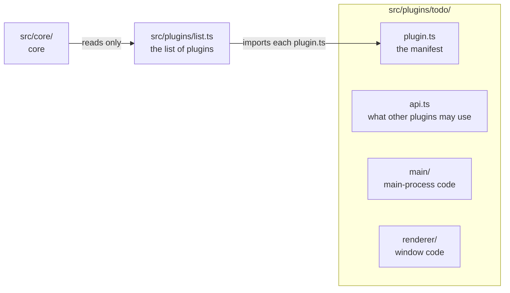

# Koloft plugin format

Format version 1, a draft. Only plugins built into Koloft exist, and nothing in the app reads
a plugin's manifest yet.

This page says what a Koloft plugin is and what its manifest (the plain-data file that says
what the plugin is and what it owns) contains. It is written for someone who has not read
Koloft's code.

- A plugin is one feature of Koloft as one piece: its text for agents, its commands, the
  session moments it listens to, its settings, its buttons and pages, and its code.
- A plugin is a folder, `src/plugins/<id>/`, with a manifest in `plugin.ts`. The type of a
  manifest is `PluginManifest` in `src/core/plugin.ts`.
- A plugin imports only core, its own folder and the `api.ts` of the plugins it says it
  needs.
- Not promised yet: installing a plugin from outside Koloft, keeping a plugin's code apart
  from the rest of Koloft, and a permission model. Today a plugin is source code built into
  the app.
- The format can still change at version 1, because no test holds its shape yet
  (see [Format version](#format-version)).

## What a plugin owns

A plugin owns six things. The plan is that turning an optional plugin off removes all six,
with no sentence and no button left behind. Switches are not built yet.

| # | A plugin owns | Manifest field | Example (Discord) |
|---|---|---|---|
| 1 | Text for agents: parts of the butler's prompt, of every session's prompt and of the `koloft` skill | `text`, `skills` | the Discord part of the session prompt |
| 2 | Commands an agent runs | `commands` | `koloft discord …` |
| 3 | Session moments it announces or listens to | `moments` | a turn ended, a file was opened |
| 4 | Settings, with its own settings page | `settings` | the bot, the bound channel |
| 5 | UI entries | `ui` | dialogs, sidebar rows, ⌘P items |
| 6 | Code, in its own folder | none: the code lives in the folder | `src/plugins/discord/` |

A plugin also says whether it is mandatory and which plugins it needs. It may list
Assist jobs (`assistJobs`), the IPC channels it uses (`channels`), and MCP servers
(`mcpServers`).

Code never goes into the manifest. A plugin's handlers and React parts live in its own
`main/` and `renderer/` folders and register themselves. Because of that, Koloft can read
what a plugin owns (for a settings page, help text or a switch) without running it.

## Where a plugin lives

Each plugin is one folder under `src/plugins/`, named by its id. Core, the part of Koloft
every plugin uses, lives in `src/core/`. The picture shows which file reaches which, with the
Todo plugin as the example.



| Path | What it holds | Exists today |
|---|---|---|
| `src/core/plugin.ts` | the manifest type and `PLUGIN_FORMAT_VERSION` | yes |
| `src/plugins/list.ts` | `PLUGINS`, every manifest in order; the only file that names plugins | yes |
| `src/plugins/<id>/plugin.ts` | the plugin's manifest | yes, for all eleven plugins |
| `src/plugins/<id>/main/` | code that runs in Koloft's main process | no plugin has one yet; the type-check settings already leave it out of the window's check |
| `src/plugins/<id>/renderer/` | code that runs in Koloft's window | no plugin has one yet; the type-check settings already leave it out of the main process's check |
| `src/plugins/<id>/api.ts` | what other plugins may import | no plugin has one yet |

The plan also names `prompts/`, `skill/` and `shared/` folders inside a plugin. Nothing in
the code knows them yet.

## The manifest

A manifest is a TypeScript file that exports one object named `plugin`. This is the whole
manifest of the Todo plugin today:

```ts
import { PLUGIN_FORMAT_VERSION, type PluginManifest } from '@core/plugin'

export const plugin: PluginManifest = {
  formatVersion: PLUGIN_FORMAT_VERSION,
  id: 'todo',
  name: 'Todo',
  mandatory: false,
  needs: ['butler', 'github']
}
```

Every manifest today fills only the five required fields. The other fields are typed places
for what a plugin owns; nothing in Koloft reads them yet.

### Required fields

| Field | Type | Meaning |
|---|---|---|
| `formatVersion` | the number `1` | the format version this manifest is written for |
| `id` | string | the plugin's id; equal to its folder name |
| `name` | string | the name a person sees, such as `Passwords and sign-in` |
| `mandatory` | boolean | `true`: the plugin will have no switch and is always on |
| `needs` | list of plugin ids | the plugins this plugin needs; once switches exist, turning one of them off turns this one off too |

The unit test `test/unit/pluginList.test.ts` holds these rules:

- Each folder under `src/plugins/` has exactly one manifest on the list, and its `id` is the
  folder name.
- Each plugin comes after every plugin it needs on the list. So no plugin needs itself, no
  two plugins need each other, and every id in `needs` is on the list.
- A mandatory plugin needs only mandatory plugins.

### Optional fields

Each optional field is a place for one of the things a plugin owns. A later step of the
plugin work makes Koloft read each one; until then its shape may change.

| Field | Type | Meaning | Step that makes Koloft read it |
|---|---|---|---|
| `text` | list of `TextBlock` | text the plugin adds to agents' prompts | #1969 |
| `skills` | list of strings | names of whole skills the plugin owns, such as `koloft-docs` | #1991 |
| `commands` | list of `{ verb, summary }` | `koloft <verb> …` commands, with a one-line summary | #1983 |
| `channels` | list of strings | names of the IPC channels (messages between Koloft's main process and its window) the plugin uses | #1984 |
| `moments` | `{ announces?, listens? }`, lists of strings | session moments the plugin announces and the ones it listens to | #1985 |
| `settings` | `{ page, keys }` | its settings page, and the setting keys it owns | #1986 |
| `ui` | list of `{ place, id }` | UI entries; `place` is `sidebar-row`, `centre-page`, `dialog` or `palette-item` (⌘P) | #1987 |
| `assistJobs` | list of `{ id, name }` | Assist jobs (small AI tasks Koloft runs) the plugin owns | #1988 |
| `mcpServers` | list of `{ name, command, args }` | MCP servers the plugin adds to sessions; no plugin uses one yet | not planned yet |

A `TextBlock` is a piece of text and the slot it fills:

- `slot`: the name of the place in a prompt the text goes into. A block names only its slot,
  never who reads it, so core never names a plugin.
- `text`: the text.
- `byAgent`: optional; a different text for one agent (Claude Code, Codex, Muse or
  Antigravity).
- `byModel`: optional; a different text for one model, keyed by model id.

The shape of `TextBlock` is being decided in #1969: how a block is added only when a
condition holds, and how a text carries values only known at run time (the butler's name, a
project's rules). Read `src/core/plugin.ts` for the shape in the code today.

## Format version

`PLUGIN_FORMAT_VERSION` in `src/core/plugin.ts` is `1`. Every manifest writes
`formatVersion: PLUGIN_FORMAT_VERSION`. The field's type is the number itself, so a manifest
that names another version fails Koloft's type check.

The version goes up when a manifest written for the old version would no longer mean the same
thing. Two examples:

- A new optional field: an old manifest without it means what it did. No bump.
- A field renamed, removed, or read differently: an old manifest would mean something else.
  Bump.

That rule holds only once a test holds the manifest's shape, which is #1989. Until then the
shape may still change at version 1.

What Koloft does with a manifest written for an older version, after a bump, is not decided.

## The import rule

A plugin imports only:

- core, `src/core/`;
- its own folder, `src/plugins/<id>/`;
- the `api.ts` of a plugin listed in its own `needs`. The needs of those plugins do not
  count: Todo needs Butler, Butler needs Sessions core, and Todo may not import Sessions
  core's `api.ts` unless it lists it too.

Outside `src/plugins/`, Koloft imports no plugin, except through the list,
`src/plugins/list.ts`. The list imports each plugin's `plugin.ts`.

Whether `src/shared/` (code the main process and the window share today) counts as core is
not decided.

A check that reports each import breaking this rule is #1967. It only reports; #1991 makes it
fail the build.

## Not promised yet

Today a plugin is source code in Koloft's repository, built into the app. These are not
promised, and no design for them exists yet:

- **Installing a plugin from outside.** There is no loader, no package format and no place
  to install a plugin into. The list in `src/plugins/list.ts` is the only way a plugin gets
  in.
- **Isolation.** Nothing keeps a plugin's code apart from the rest of Koloft at run time:
  no sandbox and no separate process. The import rule is about which source files import
  which; it does not limit what code does when it runs.
- **Permissions.** There is no permission model. A plugin's code can do anything Koloft can.
- **A stable registration surface.** How a plugin registers its commands, channels, moments,
  settings, UI entries and Assist jobs is built in #1983 to #1988. It is written down and
  kept stable only from #1989 on.

The owner decided that the format is built so that people outside the repository can write
plugins later. That is why the manifest carries a format version and this page exists.

## Open questions

- Does `src/shared/` count as core for the import rule?
- After the format version goes up, does Koloft still read manifests written for the old
  version?
- The final shape of `TextBlock` (#1969).
