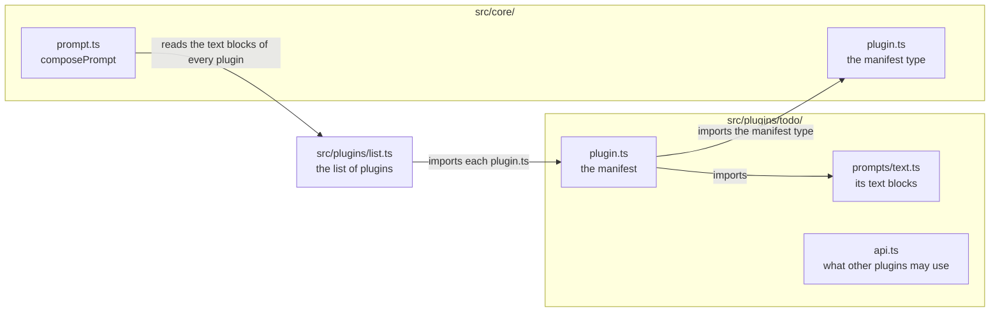

# Koloft plugin format

Format version 1, a draft. Only plugins built into Koloft exist. Of a manifest, Koloft reads
only the `text` and `assistJobs` fields today: the text it gives agents is put together from
the first, and the small jobs in Settings ▸ Assist come from the second.

This page says what a Koloft plugin is and what its manifest (the plain-data file that says
what the plugin is and what it owns) contains. It is written for someone who has not read
Koloft's code. The decision behind the format is
[ADR-0051](adr/0051-a-plugin-owns-its-feature-and-core-names-none.md) (an architecture
decision record). A number such as #1969 is an issue in
[superkoh/koloft](https://github.com/superkoh/koloft/issues) on GitHub. Each issue named
here is a step of the plan in #1964 that had not landed when this page was written; the
issue says whether it is done.

- A plugin is one feature of Koloft as one piece. It is a folder, `src/plugins/<id>/`, with
  its manifest in `plugin.ts`.
- A plugin imports only core, its own folder, and the `api.ts` of plugins it says it needs.
- The format may still change at version 1 ([Format version](#format-version)).
- Installing a plugin from outside Koloft, isolation and permissions are not promised
  ([Not promised yet](#not-promised-yet)).

## Words used on this page

- **Session**: one run of a coding agent (Claude Code, Codex, Muse or Antigravity) that
  Koloft starts in a terminal tab.
- **Owner**: the person using Koloft.
- **Butler**: a long-running session that watches the other sessions for the owner.
- **Workbench**: the panel beside each session tab: its changed files, a file browser, web
  pages and a shell. Each workspace has one too, without the shell.
- **Skill**: a set of instructions an agent loads when a task needs it. The `koloft` skill
  tells an agent how to use the `koloft` command, which an agent runs to ask Koloft for
  things.
- **Assist job**: a small AI task Koloft runs on its own, such as judging what a finished
  turn needs.
- **Core**: the code in `src/core/`, which the app and every plugin use. It is not a plugin.
  ("Sessions core" is the name of a plugin, `sessions`.)

## What a plugin owns

A plugin owns six things. Switches are not built yet. The plan in #1964 is that when an
optional plugin is off, sessions started afterwards get none of its text, its commands are
refused with one sentence, its listeners and code are not started, and its UI entries are
not shown, except a "Set up" action and its ⌘P item. Its settings and data stay on disk.

The example column says what the Discord plugin is meant to own. Today its folder holds its
manifest, its text blocks and its `api.ts`; the rest of its code still lives elsewhere in
the app.

| # | A plugin owns | Manifest field | Example (Discord) |
|---|---|---|---|
| 1 | Text for agents: parts of the butler's prompt, of every session's prompt and of the `koloft` skill | `text`, `skills` | the Discord part of the session prompt |
| 2 | `koloft` commands | `commands` | `koloft discord …` |
| 3 | Session moments it announces or listens to | `moments` | a turn ended, a file was opened |
| 4 | Settings, with its own settings page | `settings` | the bot, the bound channel |
| 5 | UI entries (things on screen) | `ui` | dialogs, sidebar rows, ⌘P (command palette) items |
| 6 | Code, in its own folder | none: the code lives in the folder | `src/plugins/discord/` |

A plugin also says whether it is mandatory and which plugins it needs. It may also list
Assist jobs (`assistJobs`), its IPC channels (`channels`: the named messages between
Koloft's main process and its window), and MCP servers (`mcpServers`: Model Context Protocol
servers, which give an agent extra tools).

Code never goes into the manifest. ADR-0051 puts a plugin's running code in its own `main/`,
`renderer/` and `shared/` folders, where it registers itself. So Koloft can read what a
plugin owns (for a settings page, help text or a switch) without running the plugin.

## The eleven plugins

These are the plugins in `src/plugins/list.ts`, in its order. A plugin is listed after
every plugin it needs. The order also decides the order of text blocks that fill the same
slot ([Text blocks](#text-blocks)).

| Id | Name | Mandatory | Needs |
|---|---|---|---|
| `sessions` | Sessions core | yes | — |
| `workbench` | Workbench | yes | — |
| `browser-control` | Browser control | yes | `workbench` |
| `butler` | Butler | yes | `sessions` |
| `inbox` | Inbox | yes | `sessions` |
| `scheduled-tasks` | Scheduled tasks | yes | `sessions` |
| `github` | GitHub | no | `sessions` |
| `discord` | Discord | no | `butler` |
| `todo` | Todo | no | `butler`, `github` |
| `passwords` | Passwords and sign-in | no | `sessions`, `workbench` |
| `docs-writing` | Docs writing | no | — |

## Where a plugin lives

Each plugin is one folder under `src/plugins/`, named by its id. The picture shows which file
imports which, with the Todo plugin as the example.



| Path | What it holds | Today |
|---|---|---|
| `src/core/plugin.ts` | the manifest type `PluginManifest` and `PLUGIN_FORMAT_VERSION` | yes |
| `src/core/prompt.ts` | `composePrompt`, which puts text blocks together | yes |
| `src/core/moment.ts` | `moment()`, a stand-in for one moment ("a file was opened") until the registry of #1985: listeners hand back a sentence for the agent's reply | yes |
| `src/core/errorText.ts` | `errorText`, the text of a thrown error | yes |
| `src/core/assistJobs.ts` | `ASSIST_JOBS`, every plugin's Assist jobs in list order, and `assistJobDefaults` | yes |
| `src/core/assistModels.ts` | the `ModelAndEffort` type and the model tables Assist jobs share | yes |
| `src/plugins/list.ts` | `PLUGINS`, every manifest in order; the only file outside the plugin folders that imports a plugin's manifest | yes |
| `src/plugins/<id>/plugin.ts` | the plugin's manifest | all eleven |
| `src/plugins/<id>/prompts/` | the plugin's text blocks for prompts | six plugins |
| `src/plugins/<id>/skill/` | the plugin's text blocks for `koloft help` and the `koloft` skill | nine plugins |
| `src/plugins/<id>/api.ts` | what other plugins may import | four plugins |
| `src/plugins/<id>/main/` | code that runs in Koloft's main process | sessions, discord |
| `src/plugins/<id>/renderer/` | code that runs in Koloft's window | none yet |
| `src/plugins/<id>/shared/` | code both of them use | sessions, workbench, butler |

Koloft's main-process type check skips every plugin's `renderer/` folder, and its window type
check skips every `main/` folder; both read the rest of a plugin folder.

## The manifest

A manifest is a TypeScript file that exports one object named `plugin`. This is the whole
manifest of the Todo plugin:

```ts
import { PLUGIN_FORMAT_VERSION, type PluginManifest } from '@core/plugin'
import { TEXT } from './prompts/text'

export const plugin: PluginManifest = {
  formatVersion: PLUGIN_FORMAT_VERSION,
  id: 'todo',
  name: 'Todo',
  mandatory: false,
  needs: ['butler', 'github'],
  text: TEXT
}
```

`@core/` and `@plugins/` are path shortcuts for `src/core/` and `src/plugins/`.

### Required fields

| Field | Type | Meaning |
|---|---|---|
| `formatVersion` | the number `1` | the format version this manifest is written for |
| `id` | string | the plugin's id; equal to its folder name |
| `name` | string | the name a person sees, such as `Passwords and sign-in` |
| `mandatory` | boolean | `true`: the plugin will have no switch and is always on |
| `needs` | list of plugin ids | the plugins this plugin needs; once switches exist, turning one of them off turns this one off too |

The unit test `test/unit/pluginList.test.ts` holds these rules:

- Each folder under `src/plugins/` has exactly one manifest on the list, and its `id` is the
  folder name.
- Each plugin comes after every plugin it needs on the list. So no plugin needs itself, no
  two plugins need each other, and every id in `needs` is on the list.
- A mandatory plugin needs only mandatory plugins.
- No two Assist jobs share an id, and none is `butler` ([Assist jobs](#assist-jobs)).

There is no other naming rule for an id.

### Optional fields

Each optional field is a place for one of the things a plugin owns. Koloft reads `text`
([Text blocks](#text-blocks)) and `assistJobs` ([Assist jobs](#assist-jobs)) today. No
manifest fills any other optional field yet, and nothing reads them; the steps in #1964 make
Koloft read them one at a time.

| Field | Type | Meaning |
|---|---|---|
| `text` | list of `TextBlock` | text the plugin adds to agents' prompts |
| `skills` | list of strings | names of whole skills the plugin owns, such as `koloft-docs` (Koloft's skill for writing documents) |
| `commands` | list of `{ verb, summary }` | each `koloft <verb> …` command, with a one-line summary |
| `channels` | list of strings | names of the IPC channels the plugin uses |
| `moments` | `{ announces?, listens? }`, each a list of strings | names of the session moments the plugin announces and those it listens to |
| `settings` | `{ page, keys }` | the name of its settings page, and the setting keys it owns |
| `ui` | list of `{ place, id }` | UI entries; `place` is `sidebar-row`, `centre-page`, `dialog` or `palette-item` (⌘P) |
| `assistJobs` | list of `{ id, name, does, defaults }` | Assist jobs the plugin owns ([Assist jobs](#assist-jobs)) |
| `mcpServers` | list of `{ name, command, args }` | MCP servers the plugin adds to sessions; a place kept for later, which no step plans to fill yet |

### Text blocks

A plugin's `text` is a list of `TextBlock`s. A text block is a piece of text and the slot it
fills:

- `slot`: the name of the place the text goes into. A block names only its slot, never who
  reads it, so core never names a plugin.
- `text`: the text.
- `byAgent`: optional; text to use instead for some agents, keyed by agent id: `claude`,
  `codex`, `muse` or `agy` (Antigravity). `eachAgent(slot, textOf)` in `src/core/plugin.ts`
  builds a block that has its own text for every agent.
- `byModel`: optional; text to use instead for some models, keyed by model id. Nothing reads
  it yet, and nothing checks the key against a list of models.
- `when`: optional; the name of a fact. The block is used only when the caller says that
  fact holds.

Inside a text, `{{name}}` (lowercase letters and hyphens) marks a place for more text.

This is the Todo plugin's one block. It adds a sentence to the part of the butler's prompt
about the `koloft` command:

```ts
import type { TextBlock } from '@core/plugin'

const SORT_OUT_THE_TO_DOS =
  'When the owner asks you to sort out the to-dos, or what waits on them, run koloft todo and do what it prints.'

export const TEXT: readonly TextBlock[] = [
  { slot: 'butler-koloft', text: ` ${SORT_OUT_THE_TO_DOS}` }
]
```

`composePrompt(slot, context)` in `src/core/prompt.ts` puts the text for a slot together. The
caller passes a context with three optional parts: `agent` (an agent id), `facts` (a list of
fact names that hold) and `values` (a map from a name to a text). It works in this order:

1. It takes every block that fills the slot, from every plugin, in the order of
   `src/plugins/list.ts`, and within one plugin in the order of its `text` list.
2. It drops each block whose `when` names a fact not in `facts`.
3. For each block left, it takes `byAgent[agent]` when there is one, else `text`.
4. It joins the texts with nothing between them, so a block starts with its own space or
   line break.
5. It fills each `{{name}}`. When the caller gave a value called `name`, it puts that value
   in as it is, and does not look for `{{…}}` inside it. Otherwise it puts the text of slot
   `name`, put together the same way with the same context. When no block fills that slot
   and no value was given, it throws an error. A slot whose blocks were all dropped by
   `when` gives empty text.

For example, the slot `butler-koloft` is filled by Sessions core, GitHub, Discord and Todo,
in that order. Discord's block there has `when: 'discord-bound'`, so its sentences are in the
butler's prompt only while Discord has a bound channel.

These are the slots, values and facts in use today:

| Kind | Name | Filled or given by |
|---|---|---|
| slot | `session` | Sessions core and Discord; the prompt every session gets |
| slot | `session-opening` | Browser control; half a sentence in the session prompt |
| slot | `question-tool` | Sessions core; the name of each agent's question tool |
| slot | `butler` | Butler; the butler's prompt |
| slot | `butler-helper` | Butler; the prompt of a helper the butler starts |
| slot | `butler-koloft` | Sessions core, GitHub, Discord, Todo; sentences in the butler's prompt |
| slot | `koloft-help` | Sessions core; the guide that `koloft help` prints, the `koloft` skill holds and the `koloft` command carries as a file, with one slot for each other section in its order |
| slot | `koloft-help-…` | one for each section, rule or half-sentence of that guide; filled by Sessions core, Workbench, Scheduled tasks, Inbox, Todo, Passwords and sign-in, Discord, GitHub and Browser control (each plugin's `skill/text.ts` names its own) |
| slot | `koloft-skill` | Sessions core; the `koloft` skill's one-line description, with slots `koloft-skill-…` where Workbench, Scheduled tasks, Todo, Passwords and sign-in and Browser control each add a few words |
| value | `butler-name` | the caller; the butler's name |
| value | `koloft-help-pick-model` | the caller; how to pick a session's model and effort in `koloft help`, the project's own rules first when it has some |
| value | `project-rules` | the caller; the rules the owner wrote for the model and effort of sessions in a project |
| fact | `discord-bound` | the caller, when Discord has a bound channel |

Who may add a slot, a value or a fact, and whether these names are kept stable for plugins
written outside Koloft, is not decided.

### Assist jobs

An Assist job is a small AI task Koloft runs on its own. A plugin lists its jobs in
`assistJobs`. Each job is:

- `id`: the job's id. The owner's pick for the job (which agent, model and thinking) is saved
  under it, so an id never changes once a job has shipped. The id `butler` is taken by the
  butler's own row.
- `name`: the job's row title in Settings ▸ Assist.
- `does`: the line under that title, saying what the job does.
- `defaults`: for each agent (`claude`, `codex`, `muse`, `agy`), the model and thinking
  (`{ model?, effort? }`) the job runs with while the owner has not picked one. An empty
  `{}` means that agent's own model and thinking.

This is the Butler plugin's one job, in `src/plugins/butler/shared/assistJobs.ts`:

```ts
import type { PluginAssistJob } from '@core/plugin'

export const ASSIST_JOBS: readonly PluginAssistJob[] = [
  {
    id: 'route',
    name: 'Route what you type in ⌘P',
    does: 'Finds the workspace, session or feature your words are for.',
    defaults: {
      claude: { model: 'sonnet', effort: 'low' },
      codex: { model: 'gpt-6.1-sol', effort: 'low' },
      muse: { effort: 'low' },
      agy: { model: 'gemini-3.8-flash', effort: 'low' }
    }
  }
]
```

`ASSIST_JOBS` in `src/core/assistJobs.ts` takes every plugin's jobs in the order of
`src/plugins/list.ts`, and within one plugin in the order of its list. Settings ▸ Assist shows
one row per job in that order, under "Small jobs". `SMALL_AND_QUICK` in
`src/core/assistModels.ts` is a `defaults` table for a job that wants the smallest, quickest
model of each agent.

The manifest says only what a job is. The code that runs a job asks Assist with the job's
`id`, and Assist runs it with the owner's pick for that id or else the job's `defaults`. Of
today's jobs only `turn` runs from its plugin's folder
(`src/plugins/sessions/main/turnNews.ts`); the others still run from `src/main/` until their
code moves.

These are the jobs today:

| Id | Plugin | Row in Settings ▸ Assist |
|---|---|---|
| `title` | Sessions core | Name a new session |
| `handover` | Sessions core | Translate a handover |
| `turn` | Sessions core | After each turn |
| `docs` | Workbench | Pick the documents to show |
| `route` | Butler | Route what you type in ⌘P |

## Format version

`PLUGIN_FORMAT_VERSION` in `src/core/plugin.ts` is `1`. A built-in manifest writes
`formatVersion: PLUGIN_FORMAT_VERSION`, so a bump moves every built-in manifest to the new
version at once. The field's
type is the number itself, so a manifest that names any other version fails Koloft's type
check. The version is there for manifests written outside Koloft later: such a manifest would
write the number it was written for.

The version goes up when a manifest written for the old version would no longer mean the same
thing:

- A new optional field: an old manifest without it means what it did. No bump.
- A new required field, or a field renamed, removed, or read differently: an old manifest
  would no longer be valid, or would mean something else. Bump.

This rule starts with #1989, which writes down how a plugin registers and adds a test that
fails whenever the manifest's shape changes. Until then the shape may still change at
version 1.

Not decided: what Koloft does with a manifest written for an older version after a bump, and
what an older Koloft does with a manifest that uses a field or value added later.

## The import rule

A plugin imports only:

- core, `src/core/`;
- its own folder, `src/plugins/<id>/`;
- the `api.ts` of a plugin listed in its own `needs`.

If A needs B and B needs C, whether A may import C's `api.ts` without listing C is not
decided. The check below allows only the plugins A lists itself.

Outside `src/plugins/`, the app's source imports no plugin, except through the list,
`src/plugins/list.ts`. The list imports each plugin's `plugin.ts`. Core reads the list, never
a plugin by name.

`src/shared/` holds code Koloft's main process and window share today, and core itself
imports from it. Whether a plugin may import `src/shared/` directly is not decided.

`npm run check:plugin-imports` lists each import under `src/` that breaks the rule; it does
not read the tests. It only reports and never fails the build; #1991 makes it fail. Today it
lists imports that the steps of #1964 still have to move: app code that imports a plugin's
`api.ts` directly, and plugins that import `src/shared/`.

## Not promised yet

Today a plugin is source code in Koloft's repository, built into the app. These are not
promised, and no design for them exists:

- **Installing a plugin from outside.** There is no loader, no package format and no place
  to install a plugin into. The list in `src/plugins/list.ts` is the only way a plugin gets
  in.
- **Isolation.** Nothing keeps a plugin's code apart from the rest of Koloft when it runs:
  no sandbox and no separate process. The import rule is about which source files import
  which; it does not limit what code does when it runs.
- **Permissions.** There is no permission model. A plugin's code can do anything Koloft can.
- **A stable way to register.** How a plugin's code registers its commands, channels,
  moments, settings, UI entries and Assist jobs is built in #1983 to #1988, and kept stable
  from #1989 on.

The owner decided that the format is built so that people outside the repository can write
plugins later. That is why the manifest carries a format version and this page exists.
