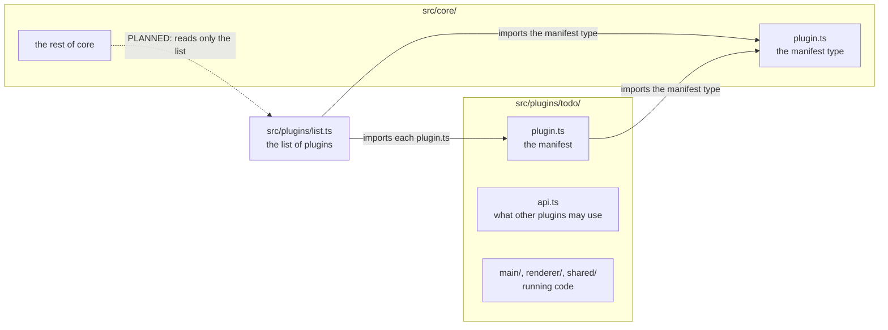

# Koloft plugin format

Format version 1, a draft. Only plugins built into Koloft exist, and nothing in the app reads
a plugin's manifest yet.

This page says what a Koloft plugin is and what its manifest (the plain-data file that says
what the plugin is and what it owns) contains. It is written for someone who has not read
Koloft's code. The decision behind the format is
[ADR-0051](adr/0051-a-plugin-owns-its-feature-and-core-names-none.md) (an architecture
decision record). A number such as #1969 is an issue in
[superkoh/koloft](https://github.com/superkoh/koloft/issues) on GitHub. Each issue named
here is a step of the plan in #1964 that had not landed when this page was written; the
issue says whether it is done.

- A plugin is one feature of Koloft as one piece. It is a folder, `src/plugins/<id>/`, with
  its manifest in `plugin.ts`.
- A plugin imports only core, its own folder, and the `api.ts` of plugins it says it needs.
- The format may still change at version 1 ([Format version](#format-version)).
- Installing a plugin from outside Koloft, isolation and permissions are not promised
  ([Not promised yet](#not-promised-yet)).

## Words used on this page

- **Session**: one run of a coding agent (Claude Code, Codex, Muse or Antigravity) that
  Koloft starts in a terminal tab.
- **Owner**: the person using Koloft.
- **Butler**: a long-running session that watches the other sessions for the owner.
- **Workbench**: the panel beside each session tab: its changed files, a file browser, web
  pages and a shell. Each workspace has one too, without the shell.
- **Skill**: a set of instructions an agent loads when a task needs it. The `koloft` skill
  tells an agent how to use the `koloft` command, which an agent runs to ask Koloft for
  things.
- **Assist job**: a small AI task Koloft runs on its own, such as judging what a finished
  turn needs.
- **Core**: the code in `src/core/`, which the app and every plugin use. It is not a plugin.
  ("Sessions core" is the name of a plugin, `sessions`.)

## What a plugin owns

A plugin owns six things. Switches are not built yet. The plan in #1964 is that when an
optional plugin is off, sessions started afterwards get none of its text, its commands are
refused with one sentence, its listeners and code are not started, and its UI entries are
not shown, except a "Set up" action and its ⌘P item. Its settings and data stay on disk. The example column says what the Discord plugin is meant
to own once its code moves into its folder.

| # | A plugin owns | Manifest field | Example (Discord) |
|---|---|---|---|
| 1 | Text for agents: parts of the butler's prompt, of every session's prompt and of the `koloft` skill | `text`, `skills` | the Discord part of the session prompt |
| 2 | `koloft` commands | `commands` | `koloft discord …` |
| 3 | Session moments it announces or listens to | `moments` | a turn ended, a file was opened |
| 4 | Settings, with its own settings page | `settings` | the bot, the bound channel |
| 5 | UI entries (things on screen) | `ui` | dialogs, sidebar rows, ⌘P (command palette) items |
| 6 | Code, in its own folder | none: the code lives in the folder | `src/plugins/discord/` |

A plugin also says whether it is mandatory and which plugins it needs. It may also list
Assist jobs (`assistJobs`), its IPC channels (`channels`: the named messages between
Koloft's main process and its window), and MCP servers (`mcpServers`: Model Context Protocol
servers, which give an agent extra tools).

Code never goes into the manifest. ADR-0051 puts a plugin's running code in its own `main/`,
`renderer/` and `shared/` folders, where it registers itself. So Koloft can read what a
plugin owns (for a settings page, help text or a switch) without running the plugin.

## The eleven plugins

These are the plugins in `src/plugins/list.ts`, in its order. A plugin is listed after
every plugin it needs.

| Id | Name | Mandatory | Needs |
|---|---|---|---|
| `sessions` | Sessions core | yes | — |
| `workbench` | Workbench | yes | — |
| `browser-control` | Browser control | yes | `workbench` |
| `butler` | Butler | yes | `sessions` |
| `inbox` | Inbox | yes | `sessions` |
| `scheduled-tasks` | Scheduled tasks | yes | `sessions` |
| `discord` | Discord | no | `butler` |
| `github` | GitHub | no | `sessions` |
| `todo` | Todo | no | `butler`, `github` |
| `passwords` | Passwords and sign-in | no | `sessions`, `workbench` |
| `docs-writing` | Docs writing | no | — |

## Where a plugin lives

Each plugin is one folder under `src/plugins/`, named by its id. The picture shows which file
imports which, with the Todo plugin as the example. A dashed arrow is planned, not built.



| Path | What it holds |
|---|---|
| `src/core/plugin.ts` | the manifest type `PluginManifest` and `PLUGIN_FORMAT_VERSION` |
| `src/plugins/list.ts` | `PLUGINS`, every manifest in order; the only file outside the plugin folders that imports plugins |
| `src/plugins/<id>/plugin.ts` | the plugin's manifest |
| `src/plugins/<id>/api.ts` | what other plugins may import |
| `src/plugins/<id>/main/` | code that runs in Koloft's main process |
| `src/plugins/<id>/renderer/` | code that runs in Koloft's window |
| `src/plugins/<id>/shared/` | code both of them use |

Today each plugin folder holds only its `plugin.ts`. Koloft's main-process type check skips
every plugin's `renderer/` folder, and its window type check skips every `main/` folder;
both read the rest of a plugin folder. The plan in #1964 also names `prompts/` and `skill/` folders
inside a plugin; nothing in the code knows them yet.

## The manifest

A manifest is a TypeScript file that exports one object named `plugin`. This is the whole
manifest of the Todo plugin:

```ts
import { PLUGIN_FORMAT_VERSION, type PluginManifest } from '@core/plugin'

export const plugin: PluginManifest = {
  formatVersion: PLUGIN_FORMAT_VERSION,
  id: 'todo',
  name: 'Todo',
  mandatory: false,
  needs: ['butler', 'github']
}
```

`@core/` and `@plugins/` are path shortcuts for `src/core/` and `src/plugins/`.

### Required fields

| Field | Type | Meaning |
|---|---|---|
| `formatVersion` | the number `1` | the format version this manifest is written for |
| `id` | string | the plugin's id; equal to its folder name |
| `name` | string | the name a person sees, such as `Passwords and sign-in` |
| `mandatory` | boolean | `true`: the plugin will have no switch and is always on |
| `needs` | list of plugin ids | the plugins this plugin needs; once switches exist, turning one of them off turns this one off too |

The unit test `test/unit/pluginList.test.ts` holds these rules:

- Each folder under `src/plugins/` has exactly one manifest on the list, and its `id` is the
  folder name.
- Each plugin comes after every plugin it needs on the list. So no plugin needs itself, no
  two plugins need each other, and every id in `needs` is on the list.
- A mandatory plugin needs only mandatory plugins.

There is no other naming rule for an id.

### Optional fields

Each optional field is a place for one of the things a plugin owns. No manifest fills one
yet, and nothing in Koloft reads them yet. The steps in #1964 make Koloft read them one at a
time.

| Field | Type | Meaning |
|---|---|---|
| `text` | list of `TextBlock` | text the plugin adds to agents' prompts |
| `skills` | list of strings | names of whole skills the plugin owns, such as `koloft-docs` (Koloft's skill for writing documents) |
| `commands` | list of `{ verb, summary }` | each `koloft <verb> …` command, with a one-line summary |
| `channels` | list of strings | names of the IPC channels the plugin uses |
| `moments` | `{ announces?, listens? }`, each a list of strings | names of the session moments the plugin announces and those it listens to |
| `settings` | `{ page, keys }` | the name of its settings page, and the setting keys it owns |
| `ui` | list of `{ place, id }` | UI entries; `place` is `sidebar-row`, `centre-page`, `dialog` or `palette-item` (⌘P) |
| `assistJobs` | list of `{ id, name }` | Assist jobs the plugin owns |
| `mcpServers` | list of `{ name, command, args }` | MCP servers the plugin adds to sessions; a place kept for later, which no step plans to fill yet |

A `TextBlock` is a piece of text and the slot it fills:

- `slot`: the name of the place in a prompt the text goes into. A block names only its slot,
  never who reads it, so core never names a plugin.
- `text`: the text.
- `byAgent`: optional; text to use instead for some agents, keyed by agent id: `claude`,
  `codex`, `muse` or `agy` (Antigravity).
- `byModel`: optional; text to use instead for some models, keyed by model id. Nothing
  checks the key against a list of models.

The shape of `TextBlock` is being decided in #1969: how a block is added only when a
condition holds, and how a text carries values only known at run time (the butler's name, a
project's rules). The type in `src/core/plugin.ts` is the shape in the code today.

## Format version

`PLUGIN_FORMAT_VERSION` in `src/core/plugin.ts` is `1`. A built-in manifest writes
`formatVersion: PLUGIN_FORMAT_VERSION`, so a bump moves every built-in manifest to the new
version at once. The field's
type is the number itself, so a manifest that names any other version fails Koloft's type
check. The version is there for manifests written outside Koloft later: such a manifest would
write the number it was written for.

The version goes up when a manifest written for the old version would no longer mean the same
thing:

- A new optional field: an old manifest without it means what it did. No bump.
- A new required field, or a field renamed, removed, or read differently: an old manifest
  would no longer be valid, or would mean something else. Bump.

This rule starts with #1989, which writes down how a plugin registers and adds a test that
fails whenever the manifest's shape changes. Until then the shape may still change at
version 1.

Not decided: what Koloft does with a manifest written for an older version after a bump, and
what an older Koloft does with a manifest that uses a field or value added later.

## The import rule

A plugin imports only:

- core, `src/core/`;
- its own folder, `src/plugins/<id>/`;
- the `api.ts` of a plugin listed in its own `needs`.

If A needs B and B needs C, whether A may import C's `api.ts` without listing C is not
decided. The check in #1967 allows only the plugins A lists itself.

Outside `src/plugins/`, the app's source imports no plugin, except through the list,
`src/plugins/list.ts`. The list imports each plugin's `plugin.ts`. The check in #1967 reads
only the source under `src/`, not the tests.

`src/shared/` holds code Koloft's main process and window share today, and
`src/core/plugin.ts` itself imports a type from it. Whether a plugin may import
`src/shared/` directly is not decided.

Nothing enforces the rule yet. #1967 adds a check that reports each import breaking it;
#1991 makes that check fail the build.

## Not promised yet

Today a plugin is source code in Koloft's repository, built into the app. These are not
promised, and no design for them exists:

- **Installing a plugin from outside.** There is no loader, no package format and no place
  to install a plugin into. The list in `src/plugins/list.ts` is the only way a plugin gets
  in.
- **Isolation.** Nothing keeps a plugin's code apart from the rest of Koloft when it runs:
  no sandbox and no separate process. The import rule is about which source files import
  which; it does not limit what code does when it runs.
- **Permissions.** There is no permission model. A plugin's code can do anything Koloft can.
- **A stable way to register.** How a plugin's code registers its commands, channels,
  moments, settings, UI entries and Assist jobs is built in #1983 to #1988, and kept stable
  from #1989 on.

The owner decided that the format is built so that people outside the repository can write
plugins later. That is why the manifest carries a format version and this page exists.
