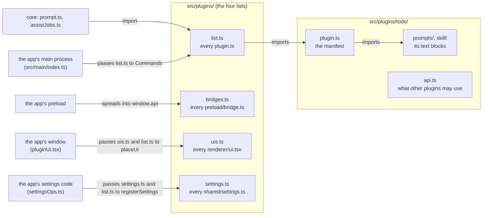
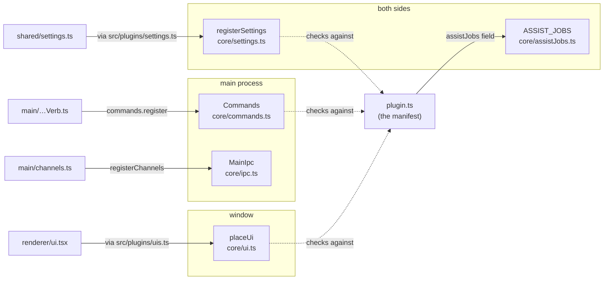

# Koloft plugin format

Format version 1, a draft. Only plugins built into Koloft exist.

This page says what a Koloft plugin is, what its manifest (the plain-data file that says what
the plugin is and what it owns) contains, and how a plugin's code plugs into Koloft. It is
written for someone who has not read Koloft's code. The decision behind the format is
[ADR-0051](adr/0051-a-plugin-owns-its-feature-and-core-names-none.md) (an architecture
decision record). A number such as #1985 is an issue in
[superkoh/koloft](https://github.com/superkoh/koloft/issues) on GitHub; the issue says whether
it is done.

- A plugin is one feature of Koloft as one piece. It is a folder, `src/plugins/<id>/`, with
  its manifest in `plugin.ts`.
- A plugin's code registers its `koloft` commands, its IPC channels, its settings and its
  UI entries with core ([How a plugin plugs in](#how-a-plugin-plugs-in)). Each registration
  is checked against the manifest: by the code that takes it, which throws an error, or by a
  unit test.
- Koloft reads five manifest fields when it runs: `text`, `commands`, `settings`, `ui` and
  `assistJobs`. A unit test reads `channels`. Nothing reads `skills`, `moments` or
  `mcpServers` yet.
- A plugin imports only core, its own folder, and the `api.ts` of plugins it says it needs.
  Much code does not follow this rule yet; a check lists each case
  ([The import rule](#the-import-rule)).
- The format may still change at version 1 ([Format version](#format-version)).
- Installing a plugin from outside Koloft, isolation, permissions and switches are not built
  ([Not built or not decided](#not-built-or-not-decided)).

## Words used on this page

- **Session**: one run of a coding agent (Claude Code, Codex, Muse or Antigravity) that
  Koloft starts in a terminal tab.
- **Owner**: the person using Koloft.
- **Butler**: a long-running session that watches the other sessions for the owner.
- **Workbench**: the panel beside each session tab: its changed files, a file browser, web
  pages and a shell. Each workspace has one too, without the shell.
- **Skill**: a set of instructions an agent loads when a task needs it. The `koloft` skill
  tells an agent how to use the `koloft` command, which an agent runs to ask Koloft for
  things.
- **Assist job**: a small AI task Koloft runs on its own, such as naming a new session.
- **Main process** and **window**: Koloft is an Electron app. Its main process runs the
  sessions and talks to the system; its window draws the screen. A **preload** is the small
  script that hands the window `window.api`, the functions it may call in the main process.
- **IPC channel** (inter-process communication): one named message between the main process
  and the window, such as `cron:list`.
- **⌘P**: Koloft's command palette, a box where the owner types words or picks an action.
- **Core**: the code in `src/core/`, which the app and every plugin use. It is not a plugin.
  ("Sessions core" is the name of a plugin, `sessions`.)

## What a plugin owns

A plugin owns six things. The example column says what the Discord plugin owns. Its folder
holds its manifest, its text blocks, its `koloft discord` command, its IPC channels, its
settings and settings page, its dialogs and what it adds to the butler's row. Its bot and
relay code still lives in `src/main/discord/`.

| # | A plugin owns | Manifest field | Example (Discord) |
|---|---|---|---|
| 1 | Text for agents: parts of the butler's prompt, of every session's prompt and of the `koloft` skill | `text`, `skills` | the Discord part of the session prompt |
| 2 | `koloft` commands | `commands` | `koloft discord …` |
| 3 | Session moments it announces or listens to | `moments` | a file was opened; a session was started by `koloft session new` |
| 4 | Settings, with its own settings page | `settings` | the bot and the bound channel; Settings ▸ Discord |
| 5 | UI entries (things on screen) | `ui` | the dialog that binds a channel |
| 6 | Code, in its own folder | none: the code lives in the folder | `src/plugins/discord/` |

A plugin also says whether it is mandatory and which plugins it needs. It may also list its
Assist jobs (`assistJobs`), its IPC channels (`channels`) and MCP servers (`mcpServers`:
Model Context Protocol servers, which give an agent extra tools).

Code never goes into the manifest. A plugin's running code lives in its own `main/`,
`preload/`, `renderer/` and `shared/` folders, where it registers itself. So Koloft can read
what a plugin owns (for a settings page, help text or a switch) without running the plugin.

## The eleven plugins

These are the plugins in `src/plugins/list.ts`, in its order. A plugin is listed after
every plugin it needs. The order also decides the order of text blocks that fill the same
slot, of UI parts in one place, and of Assist jobs.

| Id | Name | Mandatory | Needs |
|---|---|---|---|
| `sessions` | Sessions core | yes | — |
| `workbench` | Workbench | yes | — |
| `browser-control` | Browser control | yes | `workbench` |
| `butler` | Butler | yes | `sessions` |
| `inbox` | Inbox | yes | `sessions` |
| `scheduled-tasks` | Scheduled tasks | yes | `sessions` |
| `github` | GitHub | no | `sessions` |
| `discord` | Discord | no | `butler` |
| `todo` | Todo | no | `sessions`, `butler`, `github` |
| `passwords` | Passwords and sign-in | no | `sessions`, `workbench` |
| `docs-writing` | Docs writing | no | — |

This table says what each plugin's manifest fills today.

| Plugin | `commands` (`koloft …`) | `channels` | `settings` keys | `ui` entries | `assistJobs` |
|---|---|---|---|---|---|
| Sessions core | `help`, `session`, `workspace` | yes | — | — | `title`, `handover`, `turn` |
| Workbench | `open`, `diff`, `note` | yes | — | — | `docs` |
| Browser control | — | — | `browserControl` | — | — |
| Butler | — | yes | `butler`, `butlerSession`, `ownerAsleepSince` | 6 | `route` |
| Inbox | `inbox` | yes | — | 2 | — |
| Scheduled tasks | `cron` | yes | — | 2 | — |
| GitHub | `gh` | yes | — | — | — |
| Discord | `discord` | yes | `discord`, with a page | 2 | — |
| Todo | `todo` | — | `todoNotes` | — | — |
| Passwords and sign-in | `secret`, `page` | yes | — | — | — |
| Docs writing | — | — | — | — | — |

Docs writing has only its manifest so far.

## Where a plugin lives

Each plugin is one folder under `src/plugins/`, named by its id. Four list files sit next to
the folders. They are the only files outside the plugin folders that may import a plugin,
and each imports one kind of file from each plugin. The picture shows who reads which list.



### The four lists

| File | What it holds |
|---|---|
| `src/plugins/list.ts` | `PLUGINS`, every manifest in order |
| `src/plugins/bridges.ts` | `pluginBridges(ipc)`, which joins every plugin's part of `window.api`; `PluginBridges`, its type; and `KoloftApi = CoreApi & PluginBridges`, the type of `window.api` |
| `src/plugins/uis.ts` | `PLUGIN_UIS`, each plugin's UI parts and slot fills, keyed by plugin id |
| `src/plugins/settings.ts` | `PLUGIN_SETTINGS`, each plugin's setting keys, keyed by plugin id; the type of the plugins' settings comes from it |

### Core

These files in `src/core/` are what plugins build on.

| Path | What it holds |
|---|---|
| `src/core/plugin.ts` | the manifest type `PluginManifest`, `PLUGIN_FORMAT_VERSION` and `eachAgent` |
| `src/core/prompt.ts` | `composePrompt`, which puts text blocks together ([Text blocks](#text-blocks)) |
| `src/core/commands.ts` | `Commands`: the registry of `koloft` commands ([Commands](#commands)) |
| `src/core/command.ts` | what a `koloft` command answers with: `answered`, `refused`, `EXIT_USAGE`, `NOT_PINNED`, `splitAtDashes`, `fail`, `cutForATurn` and their types |
| `src/core/ipc.ts` | `MainIpc` (`handle`, `on`, `push`) and `PreloadIpc` (`invoke`, `send`, `listen`): how a plugin's code registers and uses its own IPC channels ([IPC channels](#ipc-channels)) |
| `src/core/settings.ts` | `setting`, `registerSettings` and `settingsPages` ([Settings](#settings)) |
| `src/core/ui.ts` | `slot`, `fill`, `PluginUi` and `placeUi` ([UI entries and slots](#ui-entries-and-slots)) |
| `src/core/assistJobs.ts` | `ASSIST_JOBS`, every plugin's Assist jobs in list order, and `assistJobDefaults` ([Assist jobs](#assist-jobs)) |
| `src/core/assistModels.ts` | the `ModelAndEffort` type and the model tables Assist jobs share, such as `SMALL_AND_QUICK` |
| `src/core/moment.ts` | `moment()`, a stand-in for session moments until the registry of #1985 ([Moments](#moments)) |
| `src/core/presence.ts` | `OwnerPresence`: where the owner is. `where()` answers `at-the-mac`, `away` or `asleep`, and `listenToSleep` tells a plugin when the night starts and ends. A plugin asks it and never works this out itself |
| `src/core/ownerWaits.ts` | `OwnerWaits`: a plugin marks a session as waiting on the owner, and clears that mark, with no other way to reach the attention marks |
| `src/core/webPage.ts` | `WebPage`: one Workbench web page a plugin may run a script in |
| `src/core/ownerWords.ts` | `OWNER_QUOTE_MARKS`, the marks put around the owner's own words |
| `src/core/errorText.ts` | `errorText`, the text of a thrown error |
| `src/core/mapAtMost.ts` | `mapAtMost`, a map that runs at most so many at once |

### Inside a plugin folder

A plugin folder holds these files and folders. The last column says which plugins have one
today.

| Path | What it holds | Today |
|---|---|---|
| `plugin.ts` | the plugin's manifest | all eleven |
| `prompts/` | its text blocks for prompts | sessions, browser-control, butler, github, discord, todo |
| `skill/` | its text blocks for `koloft help` and the `koloft` skill | all but butler and docs-writing |
| `api.ts` | what other plugins may import | sessions, workbench, butler, github, discord, todo |
| `main/` | code that runs in the main process | all but docs-writing |
| `preload/` | `bridge.ts`, its part of `window.api` | sessions, workbench, butler, inbox, scheduled-tasks, github, discord, passwords |
| `renderer/` | code that runs in the window; `ui.tsx` there is its UI parts and slot fills | butler, inbox, scheduled-tasks, discord |
| `shared/` | code the main process and the window both use; `ipc.ts` there is its table of IPC channels, `settings.ts` its setting keys, `assistJobs.ts` its Assist jobs | all but docs-writing |

Koloft has two type checks. The main-process one reads every plugin folder except
`renderer/` folders and `src/plugins/uis.ts`. The window one reads every plugin folder except
`main/` folders. Both read `preload/` and `shared/`. A `preload/` file imports no
`electron`; it gets a `PreloadIpc`.

## The manifest

A manifest is a TypeScript file that exports one object named `plugin`. This is the whole
manifest of the Todo plugin:

```ts
import { PLUGIN_FORMAT_VERSION, type PluginManifest } from '@core/plugin'
import { TEXT } from './prompts/text'
import { TEXT as SKILL_TEXT } from './skill/text'

export const plugin: PluginManifest = {
  formatVersion: PLUGIN_FORMAT_VERSION,
  id: 'todo',
  name: 'Todo',
  mandatory: false,
  needs: ['sessions', 'butler', 'github'],
  settings: { keys: ['todoNotes'] },
  commands: [{ verb: 'todo' }],
  text: [...TEXT, ...SKILL_TEXT]
}
```

`@core/` and `@plugins/` are path shortcuts for `src/core/` and `src/plugins/`.

### Required fields

| Field | Type | Meaning |
|---|---|---|
| `formatVersion` | the number `1` | the format version this manifest is written for |
| `id` | string | the plugin's id; equal to its folder name |
| `name` | string | the name a person sees, such as `Passwords and sign-in` |
| `mandatory` | boolean | `true`: the plugin will have no switch and is always on |
| `needs` | list of plugin ids | the plugins this plugin needs; once switches exist, turning one of them off turns this one off too |

The unit test `test/unit/pluginList.test.ts` holds these rules:

- Each folder under `src/plugins/` has exactly one manifest on the list, and its `id` is the
  folder name.
- Each plugin comes after every plugin it needs on the list. So no plugin needs itself, no
  two plugins need each other, and every id in `needs` is on the list.
- A mandatory plugin needs only mandatory plugins.
- No two Assist jobs share an id, and none is `butler`.

There is no other naming rule for an id.

### Optional fields

Each optional field is a place for one of the things a plugin owns. The last column says
what reads the field today.

| Field | Type | Meaning | Read by |
|---|---|---|---|
| `text` | list of `TextBlock` | text the plugin adds to agents' prompts ([Text blocks](#text-blocks)) | `composePrompt` |
| `commands` | list of `{ verb }` | each `koloft <verb>` command the plugin owns ([Commands](#commands)) | `Commands` |
| `channels` | list of strings | the IPC channels the plugin's code uses, written `Object.values(CHANNELS)` ([IPC channels](#ipc-channels)) | the unit test `test/unit/ipcChannels.test.ts` only |
| `settings` | `{ page?: { label, words }, keys }` | the setting keys it owns, and its settings page if it has one ([Settings](#settings)) | `registerSettings`, `settingsPages` |
| `ui` | list of `{ place, id }` | its UI entries ([UI entries and slots](#ui-entries-and-slots)) | `placeUi`, `settingsPages` |
| `assistJobs` | list of `{ id, name, does, defaults }` | its Assist jobs ([Assist jobs](#assist-jobs)) | `ASSIST_JOBS` |
| `skills` | list of strings | names of whole skills the plugin owns, such as `koloft-docs` (Koloft's skill for writing documents) | nothing yet; no manifest fills it |
| `moments` | `{ announces?, listens? }`, each a list of strings | names of the session moments the plugin announces and those it listens to | nothing yet; no manifest fills it |
| `mcpServers` | list of `{ name, command, args }` | MCP servers the plugin adds to sessions; a place kept for later, which no step plans to fill yet | nothing; no manifest fills it |

## How a plugin plugs in

The manifest says what a plugin owns. For commands, IPC channels, settings and UI entries,
the plugin's code then registers the matching pieces, and each is checked against the
manifest. Text blocks and Assist jobs live in the manifest itself, so core reads them
straight from it. The picture shows where each piece goes and what checks it.



A mismatch is caught in one of three ways:

- `Commands` throws when the main process starts and registers the commands.
- `registerSettings` throws when the settings code first loads, in the main process and in
  the window; `placeUi` throws when the window first places plugin UI. Either way the app
  does not run with the mistake.
- IPC channels and Assist job ids are checked only by unit tests
  (`test/unit/ipcChannels.test.ts`, `test/unit/pluginList.test.ts`).

The sections below take one kind of piece each, then moments and main-process parts, which
have no registry yet.

### Text blocks

A plugin's `text` is a list of `TextBlock`s. A text block is a piece of text and the slot it
fills:

- `slot`: the name of the place the text goes into. A block names only its slot, never who
  reads it, so core never names a plugin.
- `text`: the text.
- `byAgent`: optional; text to use instead for some agents, keyed by agent id: `claude`,
  `codex`, `muse` or `agy` (Antigravity). `eachAgent(slot, textOf)` in `src/core/plugin.ts`
  builds a block that has its own text for every agent.
- `byModel`: optional; text to use instead for some models, keyed by model id. Nothing reads
  it yet, and nothing checks the key against a list of models.
- `when`: optional; the name of a fact. The block is used only when the caller says that
  fact holds.

Inside a text, `{{name}}` (lowercase letters and hyphens) marks a place for more text.

This is the Todo plugin's block in `prompts/text.ts`. It adds a sentence to the part of the
butler's prompt about the `koloft` command:

```ts
import type { TextBlock } from '@core/plugin'

const SORT_OUT_THE_TO_DOS =
  'When the owner asks you to sort out the to-dos, or what waits on them, run koloft todo and do what it prints.'

export const TEXT: readonly TextBlock[] = [
  { slot: 'butler-koloft', text: ` ${SORT_OUT_THE_TO_DOS}` }
]
```

`composePrompt(slot, context)` in `src/core/prompt.ts` puts the text for a slot together. The
caller passes a context with three optional parts: `agent` (an agent id), `facts` (a list of
fact names that hold) and `values` (a map from a name to a text). It works in this order:

1. It takes every block that fills the slot, from every plugin, in the order of
   `src/plugins/list.ts`, and within one plugin in the order of its `text` list.
2. It drops each block whose `when` names a fact not in `facts`.
3. For each block left, it takes `byAgent[agent]` when there is one, else `text`.
4. It joins the texts with nothing between them, so a block starts with its own space or
   line break.
5. It fills each `{{name}}`. When the caller gave a value called `name`, it puts that value
   in as it is, and does not look for `{{…}}` inside it. Otherwise it puts the text of slot
   `name`, put together the same way with the same context. When no block fills that slot
   and no value was given, it throws an error. A slot whose blocks were all dropped by
   `when` gives empty text.

For example, the slot `butler-koloft` is filled by Sessions core, GitHub, Discord and Todo,
in that order. Discord's block there has `when: 'discord-bound'`, so its sentences are in the
butler's prompt only while Discord has a bound channel.

These are the slots, values and facts in use today:

| Kind | Name | Filled or given by |
|---|---|---|
| slot | `session` | Sessions core and Discord; the prompt every session gets |
| slot | `session-opening` | Browser control; half a sentence in the session prompt |
| slot | `question-tool` | Sessions core; the name of each agent's question tool |
| slot | `butler` | Butler; the butler's prompt |
| slot | `butler-helper` | Butler; the prompt of a helper the butler starts |
| slot | `butler-owner-instructions` | Butler; the owner's own instructions for the butler, put last in the butler's and its helpers' prompt when the owner wrote some |
| slot | `butler-koloft` | Sessions core, GitHub, Discord, Todo; sentences in the butler's prompt |
| slot | `koloft-help` | Sessions core; the guide that `koloft help` prints, the `koloft` skill holds and the `koloft` command carries as a file, with one slot for each other section in its order |
| slot | `koloft-help-…` | one for each section, rule or half-sentence of that guide; filled by Sessions core, Workbench, Scheduled tasks, Inbox, Todo, Passwords and sign-in, Discord, GitHub and Browser control (each plugin's `skill/text.ts` names its own) |
| slot | `koloft-skill` | Sessions core; the `koloft` skill's one-line description, with slots `koloft-skill-…` where Workbench, Scheduled tasks, Todo, Passwords and sign-in and Browser control each add a few words |
| value | `butler-name` | the butler's code; the butler's name |
| value | `owner-instructions` | the butler's code; what the owner wrote in the butler's Instructions |
| value | `koloft-help-pick-model` | the caller; how to pick a session's model and effort in `koloft help`, the project's own rules first when it has some |
| value | `project-rules` | the caller; the rules the owner wrote for the model and effort of sessions in a project |
| fact | `discord-bound` | the app's Discord code, when Discord has a bound channel; it reaches the butler's prompt through the butler's `roleFacts` |

### Commands

A plugin lists each `koloft <verb>` command it owns in `commands`, as `{ verb }`. No two
plugins list the same verb (`test/unit/commands.test.ts`).

The code that answers a command is not in the manifest. It registers itself with the one
`Commands` object in `src/core/commands.ts`, which the app makes at launch from the list of
plugins. This is how Scheduled tasks registers `koloft cron`:

```ts
commands.register({ cron: cronVerb(d) })
```

- A handler is `(args, caller) => reply`. `args` are the words after the verb. `caller`
  holds the session tab, its working folder and its session. The reply is `{ text, exit }`:
  `answered(text)` gives exit 0, `refused(text, exit = 1)` any other. `EXIT_USAGE` is 2.
  These live in `src/core/command.ts`.
- `register` accepts only a verb some plugin's manifest lists, and never the same verb twice.
  Either mistake throws. `register` takes no plugin id and does not check that the code
  registering a verb belongs to the plugin that lists it.
- A request for a verb nobody registered gets
  `koloft: there is no "<verb>" command. Run "koloft help" to see the commands.`, exit 2. A
  handler that throws gets `koloft: <the error>`, exit 1.
- `koloft` with no words, and any `--help` before `--`, run `help`.
- What `koloft help` prints is text blocks (slot `koloft-help`), not this list.

GitHub's `koloft gh` handler is still registered from `src/main/agentGithub.ts`; #2061 moves
GitHub's code into its plugin.

### IPC channels

A plugin that talks between the main process and the window owns its channels in four
files. Scheduled tasks is the example.

1. `shared/ipc.ts` exports `CHANNELS`, an object of channel names:

   ```ts
   export const CHANNELS = {
     list: 'cron:list',
     save: 'cron:save',
     state: 'cron:state'
   } as const
   ```

   (The real table has eight channels.) No name repeats a core channel or another plugin's.
2. `plugin.ts` sets `channels: Object.values(CHANNELS)`.
3. `main/channels.ts` exports `registerChannels(ipc: MainIpc, deps)`. It calls
   `ipc.handle(CHANNELS.x, (...args) => …)` for each request the window makes and waits on,
   and `ipc.on(CHANNELS.x, (...args) => …)` for each one-way message from the window. A
   handler gets the window's arguments, not Electron's event. For each message the main
   process sends to the window, it exports a function that calls `ipc.push(CHANNELS.y, …)`;
   a plugin with many of these may export one `pushes(ipc)` that returns a function per
   channel, as Sessions core does. `deps` is what the plugin needs from the app while that
   code still lives outside the plugin. It is a set of narrow interfaces typed with
   `@shared/types`, never a type from `src/main`; `src/main/index.ts` passes it.
4. `preload/bridge.ts` exports its bridge type and `bridge(ipc: PreloadIpc)`, which returns
   its part of `window.api`: `ipc.invoke(CHANNELS.x, …)` for a request, `ipc.send(CHANNELS.x,
   …)` for a one-way message, and `ipc.listen(CHANNELS.y, cb)`, which returns a function that
   stops listening. `src/plugins/bridges.ts` spreads it into `window.api` and adds its type
   to `PluginBridges`.

Every call names its channel as `CHANNELS.<key>` on a parameter called `ipc`. The unit test
`test/unit/ipcChannels.test.ts` finds the calls that way. It checks that each manifest lists
exactly the channels its code uses, pairs each `invoke` with a `handle`, each `send` with an
`on` and each `listen` with a `push`, and checks that the main process calls each plugin's
`registerChannels` and the preload spreads `pluginBridges`.

Core keeps its own channels in `CH`, in `src/shared/ipcChannels.ts`, and its part of
`window.api` in `CoreApi`. A channel that screens outside the plugin also use stays core's,
even when its name starts like a plugin's: `toast:show`, `palette:savePicture`,
`preview:os-open` and `fs:reveal` (under `window.api.os`), `github:commit` and `github:push`
(under `window.api.git`). The `browser` and `ext` groups of web page and extension channels
are still in core's table, although their main-process code moved into Workbench and Browser
control. Which of core's groups stay core's is settled when #1984 is done.

### Settings

A plugin lists the setting keys it owns in `settings.keys`, and registers each key in its
`shared/settings.ts`. This is the Todo plugin's file:

```ts
import { setting, type SettingKeys } from '@core/settings'
import { textsIn } from '@shared/workbenchState'

export const SETTINGS = {
  todoNotes: setting<Record<string, string>>({
    default: {},
    clean: textsIn,
    keptOnReset: true,
    writtenByMainOnly: true
  })
} satisfies SettingKeys
```

A key registered with `setting` has these parts:

- `default`: its value when nothing is saved.
- `clean(raw, handed)`: turns the saved value into a valid one. `handed` is what other keys
  handed it.
- `keptOnReset`: optional; About ▸ Reset leaves it alone.
- `writtenByMainOnly`: optional; only the main process writes it, never the window.
- `retires`: optional; older keys it takes over. Each older key hands it its records, and is
  then removed.
- `handsTo`: optional; keys it hands old records to. Such a key must belong to the same
  plugin or to a plugin it needs.

`src/plugins/settings.ts` lists each plugin's `SETTINGS`. The app's settings code
(`src/shared/settingsOps.ts`) passes the list to `registerSettings`, which uses it to load,
clean, reset and save the plugins' settings beside the app's own. `registerSettings` throws
when settings are given for a plugin not on the list, a plugin registers a key its manifest
does not list or lists a key it does not register, two plugins list one key, or a key hands
records to a key that is neither its own plugin's nor one of a plugin in its own `needs`.
`test/unit/pluginSettings.test.ts` holds these rules. `src/shared/types.ts` still re-exports
the butler's and Discord's setting types for the app's `Settings` shape.

A plugin may have one settings page. It names it in two places: `settings.page` gives the
page's name in the Settings window and in ⌘P, and the extra words ⌘P also finds it by; a
`ui` entry with place `settings-page` gives its id and its part. `settingsPages` reads the
pages from the manifests and throws when a plugin names its page in only one place, or
names two. The app's own pages, before and after the plugins' pages, are in
`src/shared/settingsPanes.ts`. Today only Discord has a page.

### UI entries and slots

A plugin's window code is in `renderer/ui.tsx`, which exports `ui: PluginUi = { parts, fills }`
(`src/core/ui.ts`):

- `parts` are React components keyed by the ids the manifest's `ui` lists. The window draws
  each part at its entry's `place`.
- `fills` put values into named slots with `fill(slot, value)`. A slot is a place in core's
  window that plugins fill; the window reads every fill of a slot in the order of the list
  of plugins.

`src/plugins/uis.ts` lists each plugin's `ui`, and `placeUi` puts them in place. It throws
when a plugin registers a part its manifest does not list, lists an entry with no part (a
`palette-item` entry needs none), uses
an id another entry already has, or when parts are given for a plugin not on the list.
`test/unit/uiParts.test.tsx` holds these rules.

These are the places an entry can have:

| Place | Where it is drawn |
|---|---|
| `sidebar-head` | pinned above the sessions list |
| `sidebar-row` | inside the sessions list, above the workspaces; a part there can draw a workspace's session rows the way the sidebar does |
| `centre-page` | a page over the terminal |
| `below-terminal` | under the centre terminal, inside its frame; each part decides itself whether it shows |
| `dialog` | a dialog |
| `palette-item` | a ⌘P item; it has no part, and its run comes from the `palette-run` slot |
| `settings-page` | a page in the Settings window ([Settings](#settings)) |

These are the slots core's window offers, in `src/renderer/src/slots.ts`:

| Slot | What a plugin puts in | Filled by |
|---|---|---|
| `landing-after-close` | where the window lands after the tab on screen closes; one value | Butler |
| `workspace-claim` | `(workspace) => boolean`: a workspace the plugin shows in a row of its own. The window keeps it out of the sidebar list and puts it last when it looks through every workspace | Butler |
| `global-note` | a hook that says whether the tab on screen shows the global note instead of its workspace's | Butler |
| `row-extras` | menu items and a status line for another plugin's sidebar row, named by that row's `ui` id | Discord, for `butler-row` |
| `row-set-up` | whether another plugin's sidebar row counts as set up | Discord, for `butler-row` |
| `settings-page-icon` | the icon of a settings page the plugin lists | Discord |
| `row-mark` | `{ at, useMarkOf, Mark }`: a mark at the start of a session row's title (`at: 'title'`) or second line (`at: 'sub'`) | Scheduled tasks (title), Butler (sub: "started by …") |
| `workspace-line` | `{ useWatch, Line }`: a line under a workspace's head, above its rows | Scheduled tasks |
| `workspace-menu` | `{ label, run(wsPath) }`: an item in a workspace's right-click menu, after "Session defaults…" | Scheduled tasks |
| `palette-run` | `{ key, run(currentWs), disabled(currentWs) }`: what a `palette-item` entry does | Scheduled tasks |
| `palette-route` | `{ kind, run(prompt) }`: what to do with ⌘P words Assist routed to a kind core leaves to plugins | Discord, for `discord` |
| `palette-hand-off` | the one function that takes ⌘P words core cannot route | Butler |

A ⌘P item's label, search words and place in the list are still in `PALETTE_FEATURES`
(`src/shared/paletteFeatures.ts`). There, `PLUGIN_PALETTE_ACTIONS` names the items plugins
run (today `scheduled-jobs`). The kinds of ⌘P route core leaves to plugins are
`PLUGIN_ROUTE_KINDS` in `src/shared/sessionRoute.ts` (today `discord`). `uiParts.test.tsx`
checks that each such item and kind has exactly one plugin that runs it.

These are the `ui` entries today:

| Plugin | Entry ids and places |
|---|---|
| Butler | `butler-row` (sidebar-row); `butler-strip` (below-terminal); `butler-rename`, `butler-set-up`, `butler-instructions`, `butler-fresh` (dialog) |
| Inbox | `inbox-row` (sidebar-head); `inbox-page` (centre-page) |
| Scheduled tasks | `scheduled-jobs-dialog` (dialog); `scheduled-jobs` (palette-item) |
| Discord | `discord-bind` (dialog); `discord` (settings-page) |

### Assist jobs

An Assist job is a small AI task Koloft runs on its own. A plugin lists its jobs in
`assistJobs`. Each job is:

- `id`: the job's id. The owner's pick for the job (which agent, model and thinking) is saved
  under it, so an id never changes once a job has shipped. The id `butler` is taken by the
  butler's own row.
- `name`: the job's row title in Settings ▸ Assist.
- `does`: the line under that title, saying what the job does.
- `defaults`: for each agent (`claude`, `codex`, `muse`, `agy`), the model and thinking
  (`{ model?, effort? }`) the job runs with while the owner has not picked one. An empty
  `{}` means that agent's own model and thinking.

This is the Butler plugin's one job, in `src/plugins/butler/shared/assistJobs.ts`:

```ts
import type { PluginAssistJob } from '@core/plugin'

export const ASSIST_JOBS: readonly PluginAssistJob[] = [
  {
    id: 'route',
    name: 'Route what you type in ⌘P',
    does: 'Finds the workspace, session or feature your words are for.',
    defaults: {
      claude: { model: 'sonnet', effort: 'low' },
      codex: { model: 'gpt-6.1-sol', effort: 'low' },
      muse: { effort: 'low' },
      agy: { model: 'gemini-3.8-flash', effort: 'low' }
    }
  }
]
```

`ASSIST_JOBS` in `src/core/assistJobs.ts` takes every plugin's jobs in the order of
`src/plugins/list.ts`, and within one plugin in the order of its list. Settings ▸ Assist
shows one row per job in that order, under "Small jobs". `SMALL_AND_QUICK` in
`src/core/assistModels.ts` is a `defaults` table for a job that wants the smallest, quickest
model of each agent.

The manifest says only what a job is. The code that runs a job asks Assist with the job's
`id`, and Assist runs it with the owner's pick for that id, or else the job's `defaults`.

These are the jobs today:

| Id | Plugin | Row in Settings ▸ Assist |
|---|---|---|
| `title` | Sessions core | Name a new session |
| `handover` | Sessions core | Translate a handover |
| `turn` | Sessions core | After each turn |
| `docs` | Workbench | Pick the documents to show |
| `route` | Butler | Route what you type in ⌘P |

### Moments

A moment is something that happens to a session, which one plugin announces and others
listen to. The registry of moments is not built yet (#1985), and no manifest fills
`moments`. Until then, `moment()` in `src/core/moment.ts` is a stand-in for one moment at a
time: `src/main/index.ts` makes each one and hands it to the plugins that announce it or
listen to it. A listener may hand back a sentence; `announce` returns every sentence in the
order the listeners started listening.

There are three moments today:

- `FileOpened`, "a file was opened". Workbench announces it from `koloft open`. Discord
  listens, to send a copy to the owner's phone.
- `SessionStarting`, "a session is starting from `koloft session new`". Sessions core
  announces it; a session the owner starts or resumes does not. Its listeners hand back
  text that goes before the new session's handover; the butler hands back a helper's role.
- `SessionStarted`, "a session was started by `koloft session new`". Sessions core
  announces it. Discord listens, to give the new session its own place in Discord.

### Main-process parts

A plugin's main-process code is a set of parts. A part is a class or function in `main/`
that holds its own state. It takes what it needs from the rest of the app as a small `deps`
object, which `src/main/index.ts` builds and hands in. A part never imports another plugin
past its `api.ts`. When it needs something from a plugin that needs it in turn (Browser
control needs Workbench), `src/main/index.ts` passes a function in. For example, Workbench's
`PageRouting` gets `driverOf` and `openAsDrivingAgentsTab` as deps, which Browser control's
code answers.

Parts whose channels are still in core's `CH` table (the Workbench web page parts and
Browser control) send to the window through a `send(channel, …args)` dep, and their
handlers stay in `src/main/index.ts`. A handler there that needs Electron's own event
(the page that sent it, its frame, or a synchronous answer) takes the `IpcMainEvent`.

## Format version

`PLUGIN_FORMAT_VERSION` in `src/core/plugin.ts` is `1`. A built-in manifest writes
`formatVersion: PLUGIN_FORMAT_VERSION`, so a bump moves every built-in manifest to the new
version at once. The field's type is the number itself, so a manifest that names any other
version fails Koloft's type check. The version is there for manifests written outside Koloft
later: such a manifest would write the number it was written for.

The version goes up when a manifest written for the old version would no longer mean the same
thing:

- A new optional field: an old manifest without it means what it did. No bump.
- A new required field, or a field renamed, removed, or read differently: an old manifest
  would no longer be valid, or would mean something else. Bump.

This rule starts with #1989, which settles how a plugin registers and adds a test that
fails whenever the manifest's shape or a registry's shape changes. Until then the shape may still change at
version 1.

## The import rule

A plugin imports only:

- core, `src/core/`;
- its own folder, `src/plugins/<id>/`;
- the `api.ts` of a plugin listed in its own `needs`.

Outside `src/plugins/`, the app's source imports no plugin. Only the four lists do, each one
kind of file: `list.ts` each `plugin.ts`, `bridges.ts` each `preload/bridge.ts`, `uis.ts`
each `renderer/ui.tsx`, and `settings.ts` each `shared/settings.ts`. Core imports only
`list.ts`, never a plugin by name. The app's preload, window and settings code read the
other three lists and hand them to core.

One kind of import has no approved path yet. `src/main/index.ts` imports each plugin's
`main/channels.ts` to call its `registerChannels` (`test/unit/ipcChannels.test.ts` requires
it), the files that register `koloft` commands and moment listeners, and the main-process
parts it builds ([Main-process parts](#main-process-parts)). The check lists these as
breaking the rule ([Not built or not decided](#not-built-or-not-decided)).

`npm run check:plugin-imports` lists each import under `src/` that breaks the rule; it does
not read the tests. It only reports and never fails the build; #1991 makes it fail. The
counts fall as the steps of #1964 land; on `main` at the commit this page was last checked
against, it listed 326 imports, in four kinds:

| Kind | Count | What it is |
|---|---|---|
| names a plugin outside the lists | 90 | app code, mostly `src/main/`, that imports a plugin's `api.ts`, `main/` or `shared/` files directly |
| imports `src/shared/` | 142 | plugin code that imports `src/shared/`, which is not core |
| imports app code outside `src/core` | 93 | plugin code that imports the app's own code, such as `src/main/` modules or the window's store, icons and slots |
| imports a plugin past its `api.ts` | 1 | Discord's settings page imports a Butler `shared/` file |

## Not built or not decided

Today a plugin is source code in Koloft's repository, built into the app. These are not
built, and no design for them exists:

- **Installing a plugin from outside.** There is no loader, no package format and no place
  to install a plugin into. The list in `src/plugins/list.ts` is the only way a plugin gets
  in.
- **Isolation.** Nothing keeps a plugin's code apart from the rest of Koloft when it runs:
  no sandbox and no separate process. The import rule is about which source files import
  which; it does not limit what code does when it runs.
- **Permissions.** There is no permission model. A plugin's code can do anything Koloft can.

These are planned in #1964 but not built yet:

- **Switches.** When an optional plugin is off, sessions started afterwards get none of its
  text, its commands are refused with one sentence, its listeners and code are not started,
  and its UI entries are not shown, except a "Set up" action and its ⌘P item. Its settings
  and data stay on disk (#1991, with Settings ▸ Plugins in #1990).
- **The registry of moments** (#1985).
- **A stable way to register.** Commands, IPC channels, settings, UI entries and Assist jobs
  register as this page says, but the shapes are not kept stable until #1989.

These are not decided:

- Who may add a text slot, a value or a fact, and whether these names, and the window's UI
  slots, are kept stable for plugins written outside Koloft.
- How the app's main process starts a plugin's main-process code (its channels, commands,
  moment listeners and parts) without importing the plugin's files by name.
- If A needs B and B needs C, whether A may import C's `api.ts` without listing C. The check
  allows only the plugins A lists itself.
- Whether a plugin may import `src/shared/` directly. `src/shared/` holds code Koloft's main
  process and window share today, and core itself imports from it.
- What Koloft does with a manifest written for an older version after a bump, and what an
  older Koloft does with a manifest that uses a field or value added later.

The owner decided that the format is built so that people outside the repository can write
plugins later. That is why the manifest carries a format version and this page exists.
